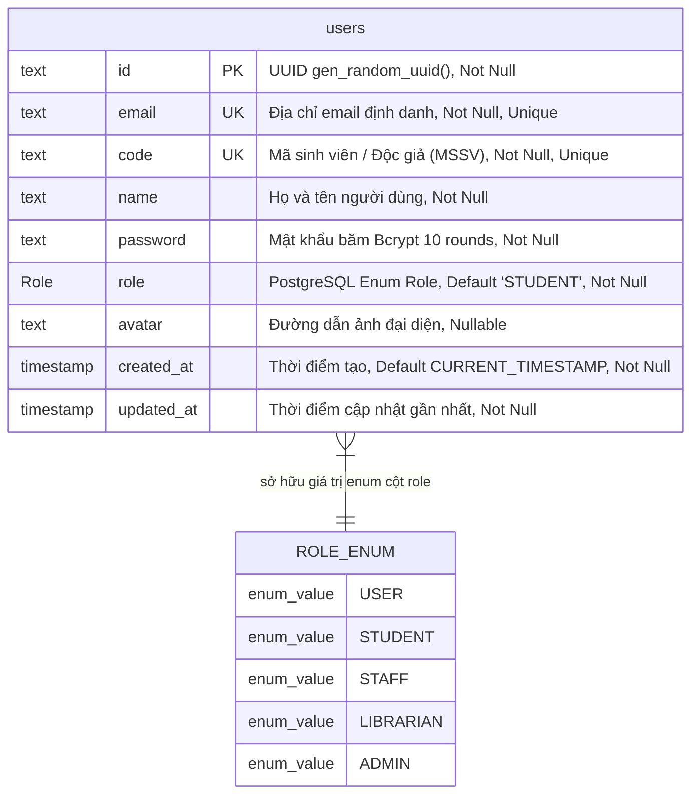
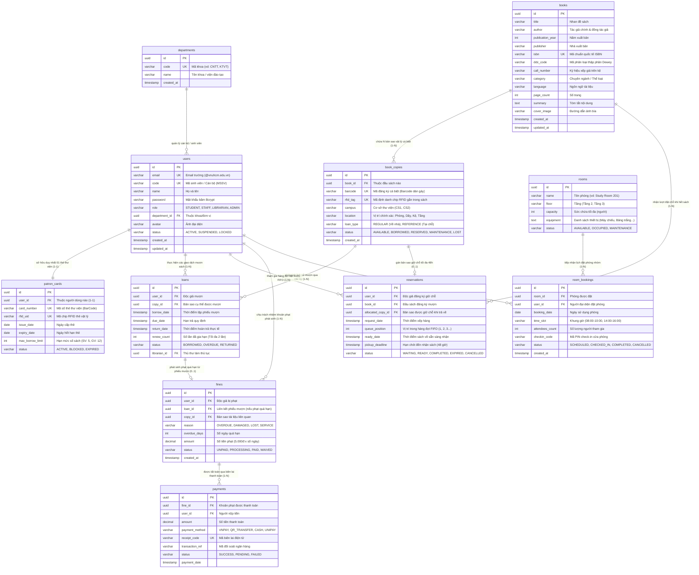

# BÁO CÁO KHẢO SÁT & BỘ SƠ ĐỒ THỰC THỂ LIÊN KẾT (DATABASE ERD)
## HỆ THỐNG QUẢN LÝ THƯ VIỆN SỐ & HỌC LIỆU ĐẠI HỌC (UNILIBRARY)

> **Dự án:** Cổng Tri Thức & Hệ Thống Quản Lý Thư Viện Đại Học (UniLibrary - Academic Digital Resource Center)  
> **Đơn vị thực hiện:** Nhóm 7 - ĐHQG-HCM  
> **Phương pháp kiểm chứng:** Truy vết mã nguồn thực tế (Codebase Audit), đối chiếu đặc tả (`rules.md`, `SRS_UniLibrary.md`, `DacTa_UniLibrary.md`) và truy vấn trực tiếp cơ sở dữ liệu PostgreSQL (`information_schema`, `pg_indexes`, `pg_enum`).

---

## 1. THÔNG BÁO VỀ KỸ NĂNG SUPERPOWERS & CÔNG CỤ KHẢO SÁT

- **Bộ kỹ năng Superpowers (`using-superpowers`, `writing-plans`, `verification-before-completion`):**
  - Đã được kích hoạt và áp dụng nghiêm ngặt xuyên suốt quá trình khảo sát.
  - Áp dụng quy tắc kiểm chứng bằng chứng thực tế (*Evidence before Assertions*): Mọi nhận định về schema và cơ sở dữ liệu bắt buộc dựa trên kết quả truy vấn thực tế từ database engine và mã nguồn thực thi, không dựa trên suy đoán từ tài liệu hay giao diện người dùng.
- **Hiện trạng hệ thống công nghệ (Verified Tech Stack):**
  - **Frontend:** Next.js 15 (App Router), React 19, TypeScript, Tailwind CSS 3.4 theo phong cách *Academic Clarity*. Toàn bộ domain types được định nghĩa tại [`client/src/types/library.ts`](../client/src/types/library.ts).
  - **Backend API:** NestJS 10.4, Modular Architecture, Passport JWT Authentication, Guards (`JwtAuthGuard`, `RolesGuard`), DTO Validation (`class-validator`).
  - **ORM & Quản lý Migration:** Prisma Client 6.4.1, cấu hình schema tại [`server/prisma/schema.prisma`](../server/prisma/schema.prisma). Chưa có thư mục migration vật lý (`prisma/migrations` chưa được khởi tạo).
  - **Cơ sở dữ liệu thực tế (Database Engine):** PostgreSQL 18 Server (`postgresql-x64-18`), đang chạy trên cổng `5432`, kết nối qua database `unilibrary` schema `public`.

---

## 2. ĐỐI CHIẾU TÀI LIỆU VỚI HIỆN TRẠNG TRIỂN KHAI

Qua đối chiếu giữa tài liệu đặc tả nghiệp vụ ([`rules.md`](../rules.md), [`docs/SRS_UniLibrary.md`](./SRS_UniLibrary.md), [`docs/DacTa_UniLibrary.md`](./DacTa_UniLibrary.md), 15 file User Stories trong [`docs/user_stories/`](./user_stories/)) với mã nguồn Backend và Database PostgreSQL thực tế:

| Phân hệ / Bảng dữ liệu | Quy định trong Tài liệu (SRS/DacTa) | Trạng thái trong Codebase | Hiện trạng trong Database PostgreSQL | Kết luận chênh lệch |
| :--- | :--- | :--- | :--- | :--- |
| **Người dùng & Thẻ (`users`)** | Lưu thông tin bạn đọc, MSSV (`code`), email, họ tên, vai trò RBAC (`STUDENT`, `STAFF`, `LIBRARIAN`, `ADMIN`). | Đã triển khai đầy đủ `AuthModule`, `UsersModule`, băm mật khẩu Bcrypt 10 rounds, xử lý bắt lỗi trùng mã sinh viên `P2002`. | **Đã tạo bảng `users` vật lý**, gồm 9 cột, 1 khóa chính PK, 2 chỉ mục duy nhất UK (`email`, `code`), 1 Native Enum `Role`. | **ĐÃ TRIỂN KHAI ĐỒNG BỘ** |
| **Danh mục Sách (`books`)** | UC01, FR-CAT-01: Quản lý đầu sách (Nhan đề, Tác giả, ISBN, DDC, Call Number, Năm XB, Số trang, Ngôn ngữ). | Frontend có interface `BookItem` ([`library.ts`](../client/src/types/library.ts)), UI tra cứu OPAC. Backend **chưa có BooksModule**. | **Chưa có bảng `books` trong Database.** Dữ liệu sách trên giao diện đang lấy từ Mock Data tĩnh. | **CÓ TRONG TÀI LIỆU, CHƯA TRIỂN KHAI BACKEND** |
| **Bản sao Cá biệt (`book_copies`)** | UC02, FR-CAT-02: Quản lý từng bản in theo Barcode/RFID, định vị kệ/tầng, trạng thái `AVAILABLE`, `BORROWED`, `RESERVED`, `LOST`. | Frontend có interface `BookCopyItem`, component hiển thị bản sao. Backend **chưa có CopyModule**. | **Chưa có bảng `book_copies` trong Database.** | **CÓ TRONG TÀI LIỆU, CHƯA TRIỂN KHAI BACKEND** |
| **Lưu thông Mượn/Trả (`loans`)** | UC08, UC09, FR-CIR-01: Ghi nhận ngày mượn, hạn trả, ngày trả, số lần gia hạn, trạng thái mượn. | Frontend có interface `LoanItem`, `LoanHistoryItem`. Backend **chưa có CirculationModule**. | **Chưa có bảng `loans` trong Database.** | **CÓ TRONG TÀI LIỆU, CHƯA TRIỂN KHAI BACKEND** |
| **Hàng đợi Đặt trước (`reservations`)** | UC11, FR-RES-01: Hàng đợi ưu tiên FIFO khi sách hết bản sao, giữ chỗ 48h khi sách hoàn trả. | Frontend có interface `ReservationItem`, màn hình `/the-thu-vien/dat-truoc`. Backend **chưa có ReservationModule**. | **Chưa có bảng `reservations` trong Database.** | **CÓ TRONG TÀI LIỆU, CHƯA TRIỂN KHAI BACKEND** |
| **Phí phạt & Thu phí (`fines`, `payments`)** | UC14, FR-CIR-02: Phạt quá hạn 5.000đ/ngày, tiền phạt hỏng/mất sách, biên lai thanh toán. | Frontend có interface `FineItem`, `PaymentItem`, trang `/the-thu-vien/phi-phat`. Backend **chưa có FinesModule**. | **Chưa có bảng `fines`, `payments` trong Database.** | **CÓ TRONG TÀI LIỆU, CHƯA TRIỂN KHAI BACKEND** |
| **Phòng học nhóm (`rooms`, `room_bookings`)** | Đặt phòng nghiên cứu, trang thiết bị, lịch sử mượn phòng. | Frontend có interface `RoomItem`, `BookingHistoryItem`, trang `/dat-phong`. | **Chưa có bảng `rooms` trong Database.** Vận hành bằng LocalStorage/Mock. | **CÓ TRONG TÀI LIỆU, CHƯA TRIỂN KHAI BACKEND** |

---

## 3. PHẦN A: SƠ ĐỒ ERD HIỆN TRẠNG (AS-BUILT DATABASE ERD)

Sơ đồ phản ánh **chính xác 100% mô hình dữ liệu vật lý đang tồn tại trong PostgreSQL** (truy vấn trực tiếp qua `information_schema.tables`, `information_schema.columns` và `pg_enum`):



### Chi tiết kỹ thuật bảng vật lý `users`:
- **Tên bảng vật lý trong PostgreSQL:** `users` (được map từ model `User` trong Prisma qua `@@map("users")`).
- **Khóa chính (PK):** Cột `id` (`text`), sinh mã tự động qua hàm `uuid()`. Chỉ mục: `users_pkey` (B-tree).
- **Khóa duy nhất (UK / Unique Constraints):**
  - `users_email_key`: Unique index trên cột `email`.
  - `users_code_key`: Unique index trên cột `code` (MSSV).
- **Kiểu dữ liệu Enum:** Cột `role` sử dụng kiểu dữ liệu do người dùng định nghĩa (`USER-DEFINED`), kiểu PostgreSQL Native Enum mang tên `"Role"`, giá trị mặc định: `'STUDENT'::"Role"`.
- **Quan hệ vật lý:** Hiện tại trong database **chưa có bảng nào khác liên kết khóa ngoại (Foreign Key)** với bảng `users`.
- **Quan hệ logic (Logic Relationships trong mã nguồn):**
  - Token JWT chứa `payload = { sub, email, code, role }` được kiểm tra qua `JwtAuthGuard` và `RolesGuard`.
  - Các thao tác mượn sách, đặt trước, thanh toán phí phạt hiện đang được quản lý logic ở mức Client State / LocalStorage gắn theo `code` (MSSV) của phiên đăng nhập.

---

## 4. PHẦN B: SƠ ĐỒ ERD MỤC TIÊU NGHIỆP VỤ (TARGET TO-BE ERD)

Dưới đây là thiết kế chuẩn hóa toàn diện cho cơ sở dữ liệu **Hệ thống Quản lý Thư viện Số & Học liệu UniLibrary**, đáp ứng trọn vẹn 15 User Stories và các quy chuẩn nghiệp vụ thư viện đại học (Bản sao cá biệt Barcode/RFID, Lưu thông Mượn/Trả, Hàng đợi FIFO Reservation, Phí phạt và Đặt phòng nghiên cứu):



---

## 5. TỪ ĐIỂN DỮ LIỆU MỤC TIÊU (TARGET DATA DICTIONARY)

### 5.1. Bảng `books` (Danh mục Đầu sách Biên mục)
- **Mục đích:** Lưu trữ bản ghi thư mục trừu tượng (Bibliographic Record) theo tiêu chuẩn quốc tế.
- **Quy tắc xóa:** `ON DELETE RESTRICT` nếu đã tồn tại bản sao trong `book_copies`.

| Tên Cột | Kiểu Dữ Liệu | Khóa / Ràng Buộc | Ý Nghĩa Nghiệp Vụ |
| :--- | :--- | :---: | :--- |
| `id` | `UUID` | **PK**, `default gen_random_uuid()` | Khóa chính duy nhất của đầu sách |
| `title` | `VARCHAR(255)` | `NOT NULL` | Nhan đề cuốn sách |
| `author` | `VARCHAR(255)` | `NOT NULL` | Tác giả chính, đồng tác giả hoặc dịch giả |
| `publication_year`| `INTEGER` | `NOT NULL` | Năm xuất bản (vd: 2024) |
| `publisher` | `VARCHAR(255)` | `NULL` | Nhà xuất bản |
| `isbn` | `VARCHAR(20)` | **UK**, `NULL` | Mã chuẩn quốc tế ISBN-10 hoặc ISBN-13 |
| `ddc_code` | `VARCHAR(20)` | `NOT NULL` | Mã phân loại Thập phân Dewey (vd: `004`, `330.015`) |
| `call_number` | `VARCHAR(50)` | `NOT NULL` | Ký hiệu xếp giá gáy sách (vd: `HB 137 .N573K 2024`) |
| `category` | `VARCHAR(100)` | `NOT NULL` | Chuyên ngành đào tạo |
| `language` | `VARCHAR(50)` | `default 'Tiếng Việt'` | Ngôn ngữ xuất bản |
| `page_count` | `INTEGER` | `NULL` | Số trang |
| `summary` | `TEXT` | `NULL` | Tóm tắt tóm lược nội dung |
| `cover_image` | `VARCHAR(500)` | `NULL` | Đường dẫn ảnh bìa sách |
| `created_at` | `TIMESTAMP` | `default now()` | Ngày tạo hồ sơ biên mục |
| `updated_at` | `TIMESTAMP` | `NOT NULL` | Ngày cập nhật gần nhất |

---

### 5.2. Bảng `book_copies` (Bản sao Cá biệt Barcode/RFID)
- **Mục đích:** Quản lý từng cuốn sách vật lý cụ thể lưu kho hoặc trên giá sách (Item Level Tracking).
- **Quy tắc toàn vẹn:** `book_id` liên kết `books.id` với `ON DELETE CASCADE`.

| Tên Cột | Kiểu Dữ Liệu | Khóa / Ràng Buộc | Ý Nghĩa Nghiệp Vụ |
| :--- | :--- | :---: | :--- |
| `id` | `UUID` | **PK**, `default gen_random_uuid()` | Khóa chính bản sao vật lý |
| `book_id` | `UUID` | **FK** $\rightarrow$ `books.id` | Đầu sách liên kết |
| `barcode` | `VARCHAR(50)` | **UK**, `NOT NULL` | Mã vạch ĐKCB dán trên gáy sách (vd: `BC-004-2026-01`) |
| `rfid_tag` | `VARCHAR(100)` | **UK**, `NULL` | Mã EPC/UID của chip RFID gắn trong bìa sách |
| `campus` | `VARCHAR(50)` | `default 'Cơ sở chính'` | Phân hiệu / cơ sở thư viện |
| `location` | `VARCHAR(100)` | `NOT NULL` | Vị trí chính xác: Phòng đọc, Dãy giá, Tầng kệ |
| `loan_type` | `VARCHAR(20)` | `default 'REGULAR'` | Loại mượn: `REGULAR` (về nhà), `REFERENCE` (chỉ đọc tại chỗ) |
| `status` | `VARCHAR(20)` | `default 'AVAILABLE'` | `AVAILABLE` (Sẵn sàng), `BORROWED` (Đang mượn), `RESERVED` (Giữ chỗ), `MAINTENANCE` (Bảo quản), `LOST` (Thất lạc) |
| `created_at` | `TIMESTAMP` | `default now()` | Thời điểm nhập kho bản sao |

---

### 5.3. Bảng `loans` (Lưu thông Mượn/Trả Sách)
- **Mục đích:** Ghi nhận chu trình mượn sách, gia hạn và tính hạn trả theo từng độc giả và bản sao.
- **Ràng buộc:** Một bản sao ở trạng thái `BORROWED` không được phép xuất hiện đồng thời trong 2 bản ghi `loans` chưa hoàn trả (`return_date IS NULL`).

| Tên Cột | Kiểu Dữ Liệu | Khóa / Ràng Buộc | Ý Nghĩa Nghiệp Vụ |
| :--- | :--- | :---: | :--- |
| `id` | `UUID` | **PK**, `default gen_random_uuid()` | Khóa chính phiếu mượn |
| `user_id` | `UUID` | **FK** $\rightarrow$ `users.id` | Độc giả mượn tài liệu |
| `copy_id` | `UUID` | **FK** $\rightarrow$ `book_copies.id` | Bản sao vật lý được xuất mượn |
| `borrow_date` | `TIMESTAMP` | `default now()` | Thời điểm quét mã mượn sách |
| `due_date` | `TIMESTAMP` | `NOT NULL` | Hạn cuối hoàn trả (SV: 14 ngày, GV: 60 ngày) |
| `return_date` | `TIMESTAMP` | `NULL` | Thời điểm trả sách thực tế tại quầy |
| `renew_count` | `INTEGER` | `default 0` | Số lần đã gia hạn thành công (Tối đa 2 lần, mỗi lần +14 ngày) |
| `status` | `VARCHAR(20)` | `default 'BORROWED'` | `BORROWED` (Đang mượn), `OVERDUE` (Quá hạn), `RETURNED` (Đã trả) |
| `librarian_id`| `UUID` | **FK** $\rightarrow$ `users.id`, `NULL` | Thủ thư chịu trách nhiệm lập phiếu |

---

### 5.4. Bảng `reservations` (Hàng đợi Đặt trước FIFO)
- **Mục đích:** Quản lý hàng đợi độc giả khi đầu sách đã hết sạch bản sao sẵn sàng.
- **Quy tắc:** Tự động gán bản sao vừa trả về cho người có `queue_position = 1`, đặt `pickup_deadline = now() + INTERVAL '48 HOURS'`.

| Tên Cột | Kiểu Dữ Liệu | Khóa / Ràng Buộc | Ý Nghĩa Nghiệp Vụ |
| :--- | :--- | :---: | :--- |
| `id` | `UUID` | **PK**, `default gen_random_uuid()` | Khóa chính yêu cầu giữ chỗ |
| `user_id` | `UUID` | **FK** $\rightarrow$ `users.id` | Độc giả xếp hàng đặt trước |
| `book_id` | `UUID` | **FK** $\rightarrow$ `books.id` | Đầu sách cần đặt |
| `allocated_copy_id`| `UUID` | **FK** $\rightarrow$ `book_copies.id`, `NULL` | Bản sao cụ thể được gán giữ chỗ sau khi trả về |
| `request_date`| `TIMESTAMP` | `default now()` | Thời điểm bấm đặt trước trên web |
| `queue_position` | `INTEGER` | `NOT NULL` | Thứ tự ưu tiên trong hàng đợi FIFO |
| `ready_date` | `TIMESTAMP` | `NULL` | Thời điểm sách được giữ chỗ sẵn sàng ở quầy |
| `pickup_deadline` | `TIMESTAMP` | `NULL` | Hạn chót độc giả phải đến quầy nhận sách (48h) |
| `status` | `VARCHAR(20)` | `default 'WAITING'` | `WAITING` (Chờ sách về), `READY` (Sẵn sàng nhận), `COMPLETED` (Đã lấy sách), `EXPIRED` (Quá 48h tự hủy), `CANCELLED` (Độc giả tự hủy) |

---

### 5.5. Bảng `fines` & `payments` (Phạt Quá hạn, Đền bù & Thanh toán)

| Bảng | Tên Cột | Kiểu Dữ Liệu | Khóa / Ràng Buộc | Ý Nghĩa Nghiệp Vụ |
| :--- | :--- | :--- | :---: | :--- |
| **`fines`** | `id` | `UUID` | **PK** | Khóa chính khoản phạt |
| | `user_id` | `UUID` | **FK** $\rightarrow$ `users.id` | Độc giả chịu phí vi phạm |
| | `loan_id` | `UUID` | **FK** $\rightarrow$ `loans.id`, `NULL` | Phiếu mượn quá hạn tương ứng |
| | `copy_id` | `UUID` | **FK** $\rightarrow$ `book_copies.id`, `NULL`| Cuốn sách bị hư hỏng hoặc làm mất |
| | `reason` | `VARCHAR(50)` | `NOT NULL` | `OVERDUE` (Quá hạn), `DAMAGED` (Hỏng), `LOST` (Mất) |
| | `overdue_days` | `INTEGER` | `default 0` | Số ngày trễ hạn |
| | `amount` | `DECIMAL(12,2)` | `NOT NULL` | Số tiền phạt ($5.000\text{đ} \times \text{ngày}$) |
| | `status` | `VARCHAR(20)` | `default 'UNPAID'` | `UNPAID` (Chưa nộp), `PROCESSING` (Chờ đối soát), `PAID` (Đã nộp), `WAIVED` (Miễn giảm) |
| **`payments`** | `id` | `UUID` | **PK** | Khóa chính biên lai |
| | `fine_id` | `UUID` | **FK** $\rightarrow$ `fines.id` | Khoản phạt được đóng |
| | `user_id` | `UUID` | **FK** $\rightarrow$ `users.id` | Độc giả nộp tiền |
| | `amount` | `DECIMAL(12,2)` | `NOT NULL` | Số tiền thực đóng |
| | `payment_method` | `VARCHAR(30)` | `NOT NULL` | `VNPAY`, `QR_TRANSFER`, `CASH`, `UNIPAY` |
| | `receipt_code` | `VARCHAR(50)` | **UK**, `NOT NULL` | Mã số biên lai thu tiền điện tử |
| | `status` | `VARCHAR(20)` | `default 'SUCCESS'` | `SUCCESS` (Thành công), `PENDING`, `FAILED` |
| | `payment_date` | `TIMESTAMP` | `default now()` | Thời điểm giao dịch thành công |

---

## 6. LỘ TRÌNH TRIỂN KHAI SCHEMA VÀO MÃ NGUỒN PRISMA

Để đưa cơ sở dữ liệu từ **Hiện trạng (Chỉ có bảng `users`)** lên **Mục tiêu hoàn chỉnh**, nhóm thực hiện theo 3 giai đoạn:

1. **Giai đoạn 1 (Catalog & Copy Management):**
   - Thêm model `Book` và `BookCopy` vào [`server/prisma/schema.prisma`](../server/prisma/schema.prisma).
   - Chạy lệnh migration:
     ```bash
     npx prisma migrate dev --name init_catalog_and_copies
     ```
2. **Giai đoạn 2 (Circulation & Reservation Engine):**
   - Bổ sung model `Loan` và `Reservation` liên kết chặt chẽ với `User` và `BookCopy`.
   - Thiết lập Transaction trong `CirculationService` để tự động chuyển trạng thái bản sao và cập nhật hàng đợi FIFO.
3. **Giai đoạn 3 (Fines & Room Booking):**
   - Tích hợp model `Fine`, `Payment`, `Room`, `RoomBooking`.
   - Kết nối cổng thanh toán VNPAY / QR Code và đối soát công nợ tự động.
