# TÀI LIỆU THIẾT KẾ KIẾN TRÚC & ĐẶC TẢ GIAO DIỆN LẬP TRÌNH ỨNG DỤNG (API DESIGN SPECIFICATION)
## HỆ THỐNG QUẢN LÝ THƯ VIỆN SỐ & HỌC LIỆU ĐẠI HỌC (UNILIBRARY)

> **Dự án:** Cổng Tri Thức & Hệ Thống Quản Lý Thư Viện Đại Học (UniLibrary - Academic Digital Resource Center)  
> **Phiên bản tài liệu:** v1.0.0  
> **Ngày lập:** 31/10/2026  
> **Đơn vị thực hiện:** Nhóm 7 - Đại học Quốc gia TP.HCM  
> **Căn cứ khảo sát & thiết kế:** Mã nguồn thực tế (`server/src/`, `server/prisma/`, `client/src/`), các tài liệu đặc tả nghiệp vụ ([`rules.md`](../rules.md), [`design.md`](../design.md), [`docs/SRS_UniLibrary.md`](./SRS_UniLibrary.md), [`docs/DacTa_UniLibrary.md`](./DacTa_UniLibrary.md), [`docs/ERD_UniLibrary.md`](./ERD_UniLibrary.md), 15 file User Stories trong [`docs/user_stories/`](./user_stories/)).

---

## 1. THÔNG BÁO VỀ KỸ NĂNG & PHƯƠNG PHÁP KHẢO SÁT

Tài liệu này được biên soạn với sự phối hợp chặt chẽ của các kỹ năng tiêu chuẩn:
1. **Superpowers Suite:**
   - **`brainstorming`**: Khảo sát khoảng trống (gap analysis) giữa UI thực tế, controller hiện hữu và các yêu cầu nghiệp vụ theo 15 User Stories; phân tích các điểm nghẽn về đồng bộ dữ liệu (state synchronization), các quyết định kỹ thuật còn thiếu (race conditions, hàng đợi FIFO, bảo toàn tính toán tài chính).
   - **`writing-plans`**: Cấu trúc tài liệu theo mô hình phân rã rõ ràng: từ tiêu chuẩn kiến trúc dùng chung, ma trận tổng hợp, đặc tả chi tiết từng endpoint, đối chiếu toàn luồng tương tác End-to-End, đến kế hoạch kiểm thử và lộ trình triển khai theo giai đoạn.
   - **`verification-before-completion`**: Áp dụng nguyên tắc "Bằng chứng trước khi khẳng định" (*Evidence before Assertions*). Tách bạch 100% giữa **API Hiện có đã xác minh qua code thực thi** và **API Mới đề xuất**; không mô tả tính năng giả định như đã hoàn thành.
2. **UI UX Pro Max:**
   - Khảo sát toàn diện 18 màn hình và luồng thao tác của Next.js Frontend ([`client/src/app/`](../client/src/app/)).
   - Định nghĩa chính xác các trạng thái giao diện cần API hỗ trợ: `loading` (Skeleton/Spinner), `empty` (Không có dữ liệu), `error` (Lỗi mạng 0, lỗi 400 validation, 401 hết hạn phiên, 403 cấm truy cập, 404 không tìm thấy, 409 xung đột, 422 lỗi nghiệp vụ, 500 lỗi máy chủ), `pagination` (phân trang chuẩn hóa), `validation` (chi tiết trường bị lỗi) và `permissions` (ẩn/vô hiệu hóa nút theo vai trò).
   - Giữ nguyên quy chuẩn giao diện và màu sắc học thuật *Academic Clarity* theo [`design.md`](../design.md).

---

## 2. TỔNG QUAN HỆ THỐNG API (SYSTEM OVERVIEW & CONVENTIONS)

### 2.1. Mục đích và Phạm vi
Hệ thống API UniLibrary đóng vai trò là nền tảng xử lý nghiệp vụ trung tâm kết nối giữa Cổng Độc giả & Quản lý Thư viện Frontend (Next.js 15) với Cơ sở dữ liệu quan hệ PostgreSQL 18 qua ORM Prisma 6.4. Hệ thống đảm bảo tính toàn vẹn dữ liệu, kiểm soát lưu thông mượn/trả, hàng đợi đặt trước và bảo mật phân quyền theo chuẩn RBAC.

### 2.2. Base URL & Môi trường Triển khai
Căn cứ cấu hình tại [`server/src/main.ts`](../server/src/main.ts) và [`client/src/services/auth.ts`](../client/src/services/auth.ts):
- **Development Local Base URL:** `http://localhost:5000/api` (hoặc `http://127.0.0.1:5000/api`)
- **Frontend App Origin:** `http://localhost:3000`
- **Global API Prefix:** `api` (thiết lập qua `app.setGlobalPrefix('api')`)
- **Version Strategy:** Đề xuất bổ sung tiền tố phiên bản URI `/api/v1/...` khi chuyển sang giai đoạn phát hành chính thức nhằm đảm bảo khả năng tương thích ngược (Backward Compatibility). Hiện tại mã nguồn đang chạy prefix `/api`.

### 2.3. Quy tắc Đặt tên & Chuẩn Giao thức HTTP
- **URL Path:** Sử dụng danh từ số nhiều, chữ thường, phân tách bằng dấu gạch ngang (`kebab-case`). Ví dụ: `/api/books`, `/api/room-bookings`, `/api/circulation/loans`.
- **JSON Property Names:** Bắt buộc sử dụng `camelCase` cho toàn bộ Request Body và Response DTO (ví dụ: `bookTitle`, `borrowDate`, `renewCount`, `accessToken`).
- **Database Column Mapping:** Trong PostgreSQL sử dụng `snake_case` (ví dụ: `created_at`, `user_id`, `call_number`), được ánh xạ tự động sang `camelCase` trong Prisma Model qua `@map(...)`.
- **HTTP Methods:**
  - `GET`: Đọc/truy vấn dữ liệu (Idempotent, Safe).
  - `POST`: Tạo mới tài nguyên, thực hiện hành động nghiệp vụ (Non-idempotent).
  - `PUT`: Cập nhật toàn bộ hoặc thay đổi trạng thái tài nguyên.
  - `PATCH`: Cập nhật một phần trường dữ liệu.
  - `DELETE`: Hủy/xóa tài nguyên hoặc đưa vào trạng thái mềm (Soft Delete).
- **Content-Type:** Mặc định `application/json; charset=utf-8`. Đối với tính năng nhập liệu file/ảnh bìa: `multipart/form-data`.

### 2.4. Cơ chế Xác thực & Phân quyền (Auth & RBAC)
- **Cơ chế xác thực:** Stateless JWT (JSON Web Token).
  - Client gửi token qua HTTP Header: `Authorization: Bearer <accessToken>`.
  - Secret Key: Cấu hình qua biến môi trường `JWT_SECRET`.
  - Thời hạn: `1d` cho Access Token, `7d` cho Refresh Token (đề xuất bổ sung).
- **Hệ thống Vai trò (Roles Matrix) theo Native PostgreSQL Enum `Role`:**
  - `STUDENT`: Sinh viên, học viên đại học. Được mượn tối đa 5 cuốn/14 ngày, tự gia hạn 2 lần, đặt trước sách, đặt phòng nhóm.
  - `USER`: Độc giả thông thường / khách nghiên cứu ngoài trường.
  - `STAFF`: Nhân viên phục vụ thư viện, trực quầy lưu thông, kiểm kê kho.
  - `LIBRARIAN`: Thủ thư chuyên trách, lập phiếu mượn/trả, biên mục đầu sách, xử lý sách hỏng/mất, thu phí phạt.
  - `ADMIN`: Quản trị viên hệ thống, toàn quyền cấu hình chính sách, quản lý người dùng, xem báo cáo thống kê toàn diện.
- **Phạm vi Truy cập Dữ liệu (Data Ownership Enforcement):**
  - Độc giả (`STUDENT`, `USER`) **chỉ được phép đọc và thao tác trên dữ liệu thuộc quyền sở hữu của chính mình** (`loan.userId === currentUser.id`, `reservation.userId === currentUser.id`, `booking.userId === currentUser.id`).
  - Backend Guards (`JwtAuthGuard`, `RolesGuard`) và Services bắt buộc chặn đứng mọi hành vi can thiệp dữ liệu chéo bằng cách trích xuất `currentUser.id` trực tiếp từ JWT Payload, không tin tưởng `userId` truyền từ URL hay Body của Client.

### 2.5. Quy ước Dữ liệu & Đơn vị Định dạng
- **Định danh duy nhất (Identifier Conventions):**
  - Khóa chính cơ sở dữ liệu (Database PK): Chuỗi UUID v4 (`String` trong Prisma, kiểu `text`/`uuid` trong PostgreSQL), ví dụ: `d290f1ee-6c54-4b01-90e6-d701748f0851`.
  - Mã sinh viên / Mã bạn đọc (`code`): Chuỗi văn bản (`text`), giữ nguyên các số `0` ở đầu, ví dụ: `2506022003`, `UL-202488`.
  - Mã Đăng ký cá biệt bản sao (`barcode`): Chuỗi chuẩn hóa in hoa, ví dụ: `UL-BK-202401-A`, `UL-AI-01`.
  - Mã xếp giá thư viện (`callNumber`): Chuỗi phân loại DDC/LCC, ví dụ: `QA 76.88 .V36 2023`.
- **Tiền tệ & Phí phạt:** Đơn vị Việt Nam Đồng (VND), lưu trữ kiểu số nguyên (`Int` hoặc `BigInt` trong Prisma/Postgres, không lưu số thập phân trôi nổi `Float` để tránh sai số tính toán tài chính), ví dụ: `25000` (25.000 đ).
- **Ngày giờ & Múi giờ:**
  - Trong API JSON: Định dạng chuỗi chuẩn quốc tế **ISO 8601 UTC** (`YYYY-MM-DDTHH:mm:ss.sssZ`), ví dụ: `2026-10-31T09:00:00.000Z`.
  - Hiển thị trên Frontend: Định dạng bản địa Việt Nam `DD/MM/YYYY` hoặc `DD/MM/YYYY HH:mm` (múi giờ `Asia/Ho_Chi_Minh` / GMT+7).

---

## 3. DANH SÁCH ENDPOINTS HỆ THỐNG

### Bảng Phân loại & Trạng thái Triển khai theo Phân hệ

| Phân hệ / Module | Method | Endpoint | Mục đích Nghiệp vụ | Phân quyền (Roles) | Trạng thái Triển khai | Vị trí Mã nguồn (Source) |
| :--- | :---: | :--- | :--- | :--- | :---: | :--- |
| **1. Auth & Identity** | `POST` | `/api/auth/register` | Đăng ký tài khoản độc giả mới | Public | **ĐÃ TRIỂN KHAI** | [`auth.controller.ts:20`](../server/src/modules/auth/auth.controller.ts#L20) |
| **1. Auth & Identity** | `POST` | `/api/auth/login` | Đăng nhập tài khoản bằng Email/MSSV | Public | **ĐÃ TRIỂN KHAI** | [`auth.controller.ts:31`](../server/src/modules/auth/auth.controller.ts#L31) |
| **1. Auth & Identity** | `GET` | `/api/auth/me` | Lấy thông tin tài khoản phiên hiện tại | Bearer Token | **ĐÃ TRIỂN KHAI** | [`auth.controller.ts:42`](../server/src/modules/auth/auth.controller.ts#L42) |
| **1. Auth & Identity** | `POST` | `/api/auth/refresh-token` | Cấp mới Access Token bằng Refresh Token | Public / Bearer | *Đề xuất mới* | `modules/auth/auth.controller.ts` |
| **1. Auth & Identity** | `POST` | `/api/auth/logout` | Đăng xuất và thu hồi Refresh Token | Bearer Token | *Đề xuất mới* | `modules/auth/auth.controller.ts` |
| **1. Auth & Identity** | `POST` | `/api/auth/change-password` | Đổi mật khẩu tài khoản người dùng | Bearer Token | *Đề xuất mới* | `modules/auth/auth.controller.ts` |
| **1. Auth & Identity** | `POST` | `/api/auth/forgot-password` | Gửi yêu cầu cấp lại mật khẩu qua email | Public | *Đề xuất mới* | `modules/auth/auth.controller.ts` |
| **2. Users & Patrons** | `GET` | `/api/users/profile` | Xem chi tiết hồ sơ độc giả & hạn mức | Bearer Token | *Đề xuất mới* | `modules/users/users.controller.ts` |
| **2. Users & Patrons** | `PUT` | `/api/users/profile` | Cập nhật thông tin cá nhân (avatar, sđt) | Bearer Token | *Đề xuất mới* | `modules/users/users.controller.ts` |
| **2. Users & Patrons** | `GET` | `/api/users` | Danh sách bạn đọc, tìm kiếm theo MSSV/tên | `ADMIN`, `LIBRARIAN` | *Đề xuất mới* | `modules/users/users.controller.ts` |
| **2. Users & Patrons** | `GET` | `/api/users/:id` | Chi tiết độc giả, công nợ và lịch sử mượn | `ADMIN`, `LIBRARIAN` | *Đề xuất mới* | `modules/users/users.controller.ts` |
| **2. Users & Patrons** | `PUT` | `/api/users/:id/role` | Cập nhật vai trò RBAC & trạng thái khóa | `ADMIN` | *Đề xuất mới* | `modules/users/users.controller.ts` |
| **3. Catalog & Books** | `GET` | `/api/books` | Tra cứu OPAC, tìm kiếm sách & lọc theo ngành | Public | *Đề xuất mới* | `modules/books/books.controller.ts` |
| **3. Catalog & Books** | `GET` | `/api/books/:id` | Chi tiết đầu sách, mục lục & danh sách bản sao | Public | *Đề xuất mới* | `modules/books/books.controller.ts` |
| **3. Catalog & Books** | `POST` | `/api/books` | Thêm mới đầu sách, biên mục DDC & ISBN | `ADMIN`, `LIBRARIAN` | *Đề xuất mới* | `modules/books/books.controller.ts` |
| **3. Catalog & Books** | `PUT` | `/api/books/:id` | Sửa thông tin ấn phẩm biên mục | `ADMIN`, `LIBRARIAN` | *Đề xuất mới* | `modules/books/books.controller.ts` |
| **3. Catalog & Books** | `DELETE` | `/api/books/:id` | Xóa đầu sách (khi chưa có giao dịch lưu thông) | `ADMIN` | *Đề xuất mới* | `modules/books/books.controller.ts` |
| **3. Catalog & Books** | `GET` | `/api/categories` | Danh mục ngành học & phân loại DDC | Public | *Đề xuất mới* | `modules/categories/categories.controller.ts` |
| **3. Catalog & Books** | `GET` | `/api/authors` | Danh sách tác giả học thuật tiêu biểu | Public | *Đề xuất mới* | `modules/authors/authors.controller.ts` |
| **3. Catalog & Books** | `GET` | `/api/books/saved` | Lấy danh sách sách đã lưu vào tủ sách cá nhân | Bearer Token | *Đề xuất mới* | `modules/books/saved-books.controller.ts` |
| **3. Catalog & Books** | `POST` | `/api/books/:id/toggle-save` | Lưu / Bỏ lưu sách vào tủ sách cá nhân | Bearer Token | *Đề xuất mới* | `modules/books/saved-books.controller.ts` |
| **4. Book Copies** | `GET` | `/api/books/:bookId/copies` | Danh sách bản sao vật lý của đầu sách | Public / Staff | *Đề xuất mới* | `modules/copies/copies.controller.ts` |
| **4. Book Copies** | `POST` | `/api/books/:bookId/copies` | Bổ sung dải bản sao vật lý mới (Mã ĐKCB) | `ADMIN`, `LIBRARIAN` | *Đề xuất mới* | `modules/copies/copies.controller.ts` |
| **4. Book Copies** | `GET` | `/api/copies/barcode/:barcode` | Quét Barcode/RFID kiểm tra bản sao tại quầy | `STAFF`, `LIBRARIAN`, `ADMIN` | *Đề xuất mới* | `modules/copies/copies.controller.ts` |
| **4. Book Copies** | `PUT` | `/api/copies/:id/status` | Chuyển trạng thái bản sao (Mất, Hỏng, Bảo quản) | `STAFF`, `LIBRARIAN`, `ADMIN` | *Đề xuất mới* | `modules/copies/copies.controller.ts` |
| **4. Book Copies** | `POST` | `/api/inventory/audit-batch` | Quét kiểm kê kho đối soát hàng loạt bản sao | `STAFF`, `LIBRARIAN`, `ADMIN` | *Đề xuất mới* | `modules/inventory/inventory.controller.ts` |
| **5. Circulation** | `GET` | `/api/circulation/loans/my-active` | Danh sách tài liệu bạn đọc đang mượn | Bearer Token | *Đề xuất mới* | `modules/circulation/circulation.controller.ts` |
| **5. Circulation** | `GET` | `/api/circulation/loans/my-history` | Lịch sử mượn trả tài liệu của bạn đọc | Bearer Token | *Đề xuất mới* | `modules/circulation/circulation.controller.ts` |
| **5. Circulation** | `POST` | `/api/circulation/checkout` | Quét thẻ & sách tạo phiếu mượn tại quầy | `STAFF`, `LIBRARIAN` | *Đề xuất mới* | `modules/circulation/circulation.controller.ts` |
| **5. Circulation** | `POST` | `/api/circulation/checkin` | Quét nhận trả sách, tự động chốt phạt quá hạn | `STAFF`, `LIBRARIAN` | *Đề xuất mới* | `modules/circulation/circulation.controller.ts` |
| **5. Circulation** | `POST` | `/api/circulation/loans/:id/renew` | Gia hạn thời gian mượn sách (Online/Quầy) | Bearer Token | *Đề xuất mới* | `modules/circulation/circulation.controller.ts` |
| **5. Circulation** | `GET` | `/api/circulation/loans/overdue` | Quét danh sách tài liệu đang quá hạn trả | `STAFF`, `LIBRARIAN`, `ADMIN` | *Đề xuất mới* | `modules/circulation/circulation.controller.ts` |
| **6. Reservations** | `GET` | `/api/reservations/my-reservations` | Danh sách sách đang đặt trước & thứ tự hàng đợi | Bearer Token | *Đề xuất mới* | `modules/reservations/reservations.controller.ts` |
| **6. Reservations** | `POST` | `/api/reservations` | Đăng ký hàng đợi FIFO đặt trước khi hết sách | Bearer Token | *Đề xuất mới* | `modules/reservations/reservations.controller.ts` |
| **6. Reservations** | `DELETE` | `/api/reservations/:id` | Hủy yêu cầu đặt trước sách | Bearer Token | *Đề xuất mới* | `modules/reservations/reservations.controller.ts` |
| **6. Reservations** | `GET` | `/api/reservations/queue/:bookId` | Xem hàng đợi FIFO ưu tiên giữ chỗ của đầu sách | `STAFF`, `LIBRARIAN` | *Đề xuất mới* | `modules/reservations/reservations.controller.ts` |
| **6. Reservations** | `POST` | `/api/reservations/:id/fulfill` | Xác nhận độc giả nhận tài liệu tại quầy giữ chỗ | `STAFF`, `LIBRARIAN` | *Đề xuất mới* | `modules/reservations/reservations.controller.ts` |
| **7. Fines & Pay** | `GET` | `/api/fines/my-fines` | Xem danh sách khoản phạt quá hạn cá nhân | Bearer Token | *Đề xuất mới* | `modules/fines/fines.controller.ts` |
| **7. Fines & Pay** | `GET` | `/api/fines` | Tra cứu toàn bộ phiếu phạt trong thư viện | `STAFF`, `LIBRARIAN`, `ADMIN` | *Đề xuất mới* | `modules/fines/fines.controller.ts` |
| **7. Fines & Pay** | `POST` | `/api/fines` | Lập phiếu phạt hư hỏng / làm mất tài liệu | `STAFF`, `LIBRARIAN` | *Đề xuất mới* | `modules/fines/fines.controller.ts` |
| **7. Fines & Pay** | `POST` | `/api/payments/create-intent` | Khởi tạo giao dịch thanh toán online (VNPAY/QR) | Bearer Token | *Đề xuất mới* | `modules/payments/payments.controller.ts` |
| **7. Fines & Pay** | `POST` | `/api/payments/pay-cash` | Ghi nhận thu phí phạt tiền mặt tại quầy | `STAFF`, `LIBRARIAN` | *Đề xuất mới* | `modules/payments/payments.controller.ts` |
| **7. Fines & Pay** | `GET` | `/api/payments/my-receipts` | Lịch sử biên lai thanh toán phí phạt | Bearer Token | *Đề xuất mới* | `modules/payments/payments.controller.ts` |
| **8. Rooms Booking** | `GET` | `/api/rooms` | Danh mục phòng nhóm, seminar & cabin tự học | Public | *Đề xuất mới* | `modules/rooms/rooms.controller.ts` |
| **8. Rooms Booking** | `GET` | `/api/rooms/:id/availability` | Tra cứu ca trống theo ngày của phòng học | Public | *Đề xuất mới* | `modules/rooms/rooms.controller.ts` |
| **8. Rooms Booking** | `GET` | `/api/room-bookings/my-bookings` | Lịch sử & danh sách đặt phòng cá nhân | Bearer Token | *Đề xuất mới* | `modules/rooms/room-bookings.controller.ts` |
| **8. Rooms Booking** | `POST` | `/api/room-bookings` | Đăng ký đặt phòng thảo luận / cabin nghiên cứu | Bearer Token | *Đề xuất mới* | `modules/rooms/room-bookings.controller.ts` |
| **8. Rooms Booking** | `DELETE` | `/api/room-bookings/:id` | Hủy yêu cầu đặt phòng trước giờ bắt đầu | Bearer Token | *Đề xuất mới* | `modules/rooms/room-bookings.controller.ts` |
| **8. Rooms Booking** | `POST` | `/api/room-bookings/:id/checkin` | Quét mã Check-in code nhận phòng | Bearer Token | *Đề xuất mới* | `modules/rooms/room-bookings.controller.ts` |
| **9. Policies** | `GET` | `/api/policies/circulation` | Xem quy định hạn mức mượn, gia hạn theo role | Public | *Đề xuất mới* | `modules/policies/policies.controller.ts` |
| **9. Policies** | `PUT` | `/api/policies/circulation/:id` | Điều chỉnh định mức mượn, đơn giá phạt/ngày | `ADMIN` | *Đề xuất mới* | `modules/policies/policies.controller.ts` |
| **10. Reports** | `GET` | `/api/reports/circulation-summary` | Báo cáo thống kê lượt mượn, trả và tỷ lệ quay vòng | `LIBRARIAN`, `ADMIN` | *Đề xuất mới* | `modules/reports/reports.controller.ts` |
| **10. Reports** | `GET` | `/api/reports/top-borrowed-books` | Bảng xếp hạng tài liệu được mượn nhiều nhất | Public / Staff | *Đề xuất mới* | `modules/reports/reports.controller.ts` |
| **10. Reports** | `GET` | `/api/reports/financial-fines` | Báo cáo doanh thu thu phí phạt và bồi thường | `ADMIN` | *Đề xuất mới* | `modules/reports/reports.controller.ts` |

---

## 4. ĐẶC TẢ CHI TIẾT CÁC ENDPOINT THEO PHÂN HỆ

### Module 1: Xác Thực & Quản Lý Phiên (Authentication & Identity)

#### 1.1. `POST /api/auth/register` [ĐÃ TRIỂN KHAI]
- **Mục đích:** Đăng ký tài khoản độc giả mới dành cho sinh viên, học viên đại học.
- **Quyền:** Public.
- **Điều kiện nghiệp vụ:**
  - `code` (MSSV) và `email` phải là duy nhất trên toàn hệ thống.
  - Mật khẩu băm an toàn qua Bcrypt (10 rounds).
  - Mặc định chỉ cấp vai trò `Role.STUDENT`. Chặn triệt để client gửi `role: "ADMIN"` để leo quyền.
- **Request Headers:** `Content-Type: application/json`
- **Request Body DTO (`RegisterDto`):**
  ```json
  {
    "name": "Đặng Hoàng Phúc",
    "code": "2506022003",
    "email": "2506022003@student.university.edu.vn",
    "password": "Password123@"
  }
  ```
  *Quy tắc kiểm tra (Validation):*
  - `name`: String, không rỗng, tối thiểu 2 ký tự.
  - `code`: String, không rỗng, chuẩn hóa cắt khoảng trắng và in hoa.
  - `email`: String, chuẩn email RFC 5322, không rỗng.
  - `password`: String, tối thiểu 6 ký tự (backend validator) và 8 ký tự kèm ký tự hoa/thường/số/ký tự đặc biệt (khuyến nghị frontend).
- **Success Response (HTTP 201 Created):**
  ```json
  {
    "statusCode": 201,
    "message": "Đăng ký tài khoản thành công",
    "data": {
      "user": {
        "id": "c1f7a0b3-9e4a-4e4b-9f9b-6b2c6a0b3e4a",
        "email": "2506022003@student.university.edu.vn",
        "code": "2506022003",
        "name": "Đặng Hoàng Phúc",
        "role": "STUDENT",
        "avatar": null,
        "createdAt": "2026-10-31T08:30:00.000Z",
        "updatedAt": "2026-10-31T08:30:00.000Z"
      },
      "accessToken": "eyJhbGciOiJIUzI1NiIsInR5cCI6IkpXVCJ9..."
    }
  }
  ```
- **Lỗi thường gặp:**
  - `400 Bad Request`: Payload thiếu trường bắt buộc hoặc sai định dạng email.
  - `409 Conflict`: `field: "code"` hoặc `field: "email"` đã tồn tại trong database (bắt lỗi `P2002`).

#### 1.2. `POST /api/auth/login` [ĐÃ TRIỂN KHAI]
- **Mục đích:** Xác thực người dùng bằng Email hoặc Mã sinh viên (`code`) kèm mật khẩu.
- **Quyền:** Public.
- **Request Body DTO (`LoginDto`):**
  ```json
  {
    "identifier": "2506022003",
    "password": "Password123@"
  }
  ```
- **Success Response (HTTP 200 OK):**
  ```json
  {
    "statusCode": 200,
    "message": "Đăng nhập thành công",
    "data": {
      "user": {
        "id": "c1f7a0b3-9e4a-4e4b-9f9b-6b2c6a0b3e4a",
        "email": "2506022003@student.university.edu.vn",
        "code": "2506022003",
        "name": "Đặng Hoàng Phúc",
        "role": "STUDENT",
        "avatar": null,
        "createdAt": "2026-10-31T08:30:00.000Z",
        "updatedAt": "2026-10-31T08:30:00.000Z"
      },
      "accessToken": "eyJhbGciOiJIUzI1NiIsInR5cCI6IkpXVCJ9..."
    }
  }
  ```
- **Lỗi thường gặp:**
  - `401 Unauthorized`: `"Email / Mã độc giả hoặc mật khẩu không chính xác"`.

#### 1.3. `GET /api/auth/me` [ĐÃ TRIỂN KHAI]
- **Mục đích:** Xác minh phiên làm việc và lấy thông tin tài khoản hiện tại từ JWT.
- **Quyền:** Bearer Token (`JwtAuthGuard`).
- **Request Headers:** `Authorization: Bearer <token>`
- **Success Response (HTTP 200 OK):**
  ```json
  {
    "statusCode": 200,
    "message": "Lấy thông tin tài khoản thành công",
    "data": {
      "id": "c1f7a0b3-9e4a-4e4b-9f9b-6b2c6a0b3e4a",
      "email": "2506022003@student.university.edu.vn",
      "code": "2506022003",
      "name": "Đặng Hoàng Phúc",
      "role": "STUDENT",
      "avatar": null,
      "createdAt": "2026-10-31T08:30:00.000Z",
      "updatedAt": "2026-10-31T08:30:00.000Z"
    }
  }
  ```
- **Lỗi thường gặp:**
  - `401 Unauthorized`: Token không hợp lệ, bị giả mạo hoặc đã hết hạn.

---

### Module 2: Quản Lý Độc Giả & Bạn Đọc (Users & Patron Profiles)

#### 2.1. `GET /api/users/profile` [ĐỀ XUẤT MỚI]
- **Mục đích:** Cung cấp thông tin thẻ thư viện số đầy đủ cho trang `/the-thu-vien`: bao gồm phòng ban/khoa, số sách đang mượn, hạn mức mượn tối đa và tổng tiền phạt chưa thanh toán.
- **Quyền:** Bearer Token (Chính chủ).
- **Success Response (HTTP 200 OK):**
  ```json
  {
    "statusCode": 200,
    "message": "Thành công",
    "data": {
      "id": "c1f7a0b3-9e4a-4e4b-9f9b-6b2c6a0b3e4a",
      "code": "2506022003",
      "name": "Đặng Hoàng Phúc",
      "email": "2506022003@student.university.edu.vn",
      "role": "STUDENT",
      "department": "Khoa Công nghệ Thông tin",
      "avatar": null,
      "cardStatus": "ACTIVE",
      "expiryDate": "2028-09-30T00:00:00.000Z",
      "activeLoansCount": 2,
      "maxLoansAllowed": 5,
      "unpaidFinesAmount": 0
    }
  }
  ```

#### 2.2. `GET /api/users/card/:code` [ĐỀ XUẤT MỚI]
- **Mục đích:** Phục vụ thủ thư tại quầy lưu thông quét mã Barcode/RFID trên Thẻ Thư viện số để nạp nhanh thông tin độc giả (Hỗ trợ Use Case UC08, UC15).
- **Quyền:** `STAFF`, `LIBRARIAN`, `ADMIN`.
- **Path Parameters:** `code`: Mã số sinh viên / mã bạn đọc.
- **Success Response (HTTP 200 OK):**
  ```json
  {
    "statusCode": 200,
    "message": "Tra cứu thẻ độc giả thành công",
    "data": {
      "id": "c1f7a0b3-9e4a-4e4b-9f9b-6b2c6a0b3e4a",
      "code": "2506022003",
      "name": "Đặng Hoàng Phúc",
      "role": "STUDENT",
      "cardStatus": "ACTIVE",
      "activeLoans": 2,
      "maxLoans": 5,
      "hasOverdue": false,
      "unpaidFines": 0
    }
  }
  ```

---

### Module 3: Danh Mục Ấn Phẩm & Tra Cứu OPAC (Catalog & Books)

#### 3.1. `GET /api/books` [ĐỀ XUẤT MỚI]
- **Mục đích:** Tra cứu ấn phẩm học thuật trên cổng OPAC ([`client/src/app/tra-cuu/page.tsx`](../client/src/app/tra-cuu/page.tsx)), hỗ trợ phân trang, lọc theo ngành, định dạng tài liệu, tình trạng còn sách trên kệ.
- **Quyền:** Public.
- **Query Parameters:**
  - `search` (string, optional): Từ khóa tìm kiếm theo Nhan đề, Tác giả, ISBN, Call Number.
  - `category` (string, optional): Slug danh mục ngành (ví dụ: `kinh-te`, `cong-nghe`).
  - `format` (string, optional): `PRINT` (Sách in), `EBOOK` (Ebook PDF), `THESIS` (Luận án TS), `OPEN_ACCESS`.
  - `available` (boolean, optional): `true` (chỉ lấy sách có bản sao sẵn sàng mượn).
  - `page` (integer, optional, default: 1): Số thứ tự trang.
  - `limit` (integer, optional, default: 10): Số kết quả trên một trang.
  - `sortBy` (string, optional, default: `createdAt`): `createdAt`, `year`, `title`.
  - `sortOrder` (string, optional, default: `desc`): `asc` hoặc `desc`.
- **Success Response (HTTP 200 OK):**
  ```json
  {
    "statusCode": 200,
    "message": "Thành công",
    "data": {
      "items": [
        {
          "id": "b1a2c3d4-e5f6-4a5b-8c9d-0e1f2a3b4c5d",
          "title": "Kinh tế học Lượng tử và Ứng dụng trong Tài chính Hiện đại",
          "author": "GS.TS. Nguyễn Văn An, ThS. Trần Minh Đức",
          "year": 2024,
          "publisher": "NXB Đại học Quốc gia TP.HCM",
          "isbn": "978-604-73-9821-4",
          "callNumber": "HB 137 .N573K 2024",
          "ddcCode": "330.0151",
          "format": "Sách in",
          "categorySlug": "kinh-te",
          "categoryName": "Kinh tế & Quản trị",
          "totalCopies": 5,
          "availableCopies": 3,
          "isAvailable": true,
          "coverImage": "https://unilibrary.edu.vn/covers/quantum-econ.jpg"
        }
      ],
      "meta": {
        "page": 1,
        "limit": 10,
        "totalItems": 48,
        "totalPages": 5,
        "hasNextPage": true,
        "hasPrevPage": false
      }
    }
  }
  ```

#### 3.2. `GET /api/books/:id` [ĐỀ XUẤT MỚI]
- **Mục đích:** Xem chi tiết một đầu sách, hiển thị mô tả, mục lục sách, vị trí kệ và trạng thái từng bản sao vật lý cá biệt ([`client/src/app/tra-cuu/[id]/page.tsx`](../client/src/app/tra-cuu/[id]/page.tsx)).
- **Quyền:** Public.
- **Path Parameters:** `id`: UUID của ấn phẩm.
- **Success Response (HTTP 200 OK):**
  ```json
  {
    "statusCode": 200,
    "message": "Thành công",
    "data": {
      "id": "b1a2c3d4-e5f6-4a5b-8c9d-0e1f2a3b4c5d",
      "title": "Kinh tế học Lượng tử và Ứng dụng trong Tài chính Hiện đại",
      "author": "GS.TS. Nguyễn Văn An, ThS. Trần Minh Đức",
      "year": 2024,
      "publisher": "NXB Đại học Quốc gia TP.HCM",
      "isbn": "978-604-73-9821-4",
      "callNumber": "HB 137 .N573K 2024",
      "ddcCode": "330.0151",
      "format": "Sách in",
      "department": "Khoa Kinh tế & QTKD",
      "language": "Tiếng Việt (Tóm tắt tiếng Anh)",
      "pageCount": 486,
      "description": "Tài liệu nghiên cứu chuyên sâu về các mô hình xác suất lượng tử áp dụng trong định giá phái sinh...",
      "tableOfContents": [
        "Chương 1: Không gian Hilbert và Cơ học Lượng tử trong Kinh tế",
        "Chương 2: Mô hình Black-Scholes Lượng tử & Định giá Quyền chọn"
      ],
      "totalCopies": 5,
      "availableCopies": 3,
      "copies": [
        {
          "id": "c101-uuid",
          "barcode": "UL-BK-202401-A",
          "campus": "Cơ sở 1 (Khuôn viên Trung tâm)",
          "location": "Tầng 3 • Khu Sách Kinh tế • Kệ E-04",
          "callNumber": "HB 137 .N573K 2024 c.1",
          "status": "AVAILABLE",
          "statusText": "Có sẵn"
        },
        {
          "id": "c102-uuid",
          "barcode": "UL-BK-202401-B",
          "campus": "Cơ sở 1 (Khuôn viên Trung tâm)",
          "location": "Tầng 3 • Khu Sách Kinh tế • Kệ E-04",
          "callNumber": "HB 137 .N573K 2024 c.2",
          "status": "BORROWED",
          "statusText": "Đang mượn",
          "dueDate": "2026-11-15T00:00:00.000Z"
        }
      ]
    }
  }
  ```

#### 3.3. `POST /api/books/:id/toggle-save` [ĐỀ XUẤT MỚI]
- **Mục đích:** Thay thế LocalStorage trong việc lưu trữ danh sách "Sách đã lưu cá nhân" ([`client/src/app/the-thu-vien/da-luu/page.tsx`](../client/src/app/the-thu-vien/da-luu/page.tsx)).
- **Quyền:** Bearer Token.
- **Success Response (HTTP 200 OK):**
  ```json
  {
    "statusCode": 200,
    "message": "Đã lưu tài liệu vào danh mục cá nhân thành công",
    "data": {
      "bookId": "b1a2c3d4-e5f6-4a5b-8c9d-0e1f2a3b4c5d",
      "isSaved": true
    }
  }
  ```

---

### Module 4: Bản Sao Vật Lý & Quản Lý Kho Sách (Copies & Inventory)

#### 4.1. `POST /api/books/:bookId/copies` [ĐỀ XUẤT MỚI]
- **Mục đích:** Lập phiếu nhập sách và sinh dải bản sao vật lý cá biệt kèm Barcode/RFID (Use Case UC02, UC04, UC05).
- **Quyền:** `ADMIN`, `LIBRARIAN`.
- **Request Body DTO:**
  ```json
  {
    "quantity": 3,
    "campus": "Cơ sở 1 (Khuôn viên Trung tâm)",
    "location": "Tầng 3 • Khu Sách Kinh tế • Kệ E-04",
    "priceVND": 185000,
    "barcodePrefix": "UL-BK-2026"
  }
  ```
- **Success Response (HTTP 201 Created):**
  ```json
  {
    "statusCode": 201,
    "message": "Tạo 3 bản sao vật lý mới thành công",
    "data": {
      "createdCopies": [
        { "id": "copy-1-uuid", "barcode": "UL-BK-202601", "status": "AVAILABLE" },
        { "id": "copy-2-uuid", "barcode": "UL-BK-202602", "status": "AVAILABLE" },
        { "id": "copy-3-uuid", "barcode": "UL-BK-202603", "status": "AVAILABLE" }
      ]
    }
  }
  ```

#### 4.2. `GET /api/copies/barcode/:barcode` [ĐỀ XUẤT MỚI]
- **Mục đích:** Quét barcode bản sao tại quầy phục vụ mượn/trả.
- **Quyền:** `STAFF`, `LIBRARIAN`, `ADMIN`.
- **Path Parameters:** `barcode`: Mã vạch dán trên gáy sách (ví dụ: `UL-BK-202401-A`).
- **Success Response (HTTP 200 OK):**
  ```json
  {
    "statusCode": 200,
    "message": "Thành công",
    "data": {
      "id": "c101-uuid",
      "barcode": "UL-BK-202401-A",
      "bookId": "b1a2c3d4-e5f6-4a5b-8c9d-0e1f2a3b4c5d",
      "bookTitle": "Kinh tế học Lượng tử và Ứng dụng trong Tài chính Hiện đại",
      "callNumber": "HB 137 .N573K 2024 c.1",
      "status": "AVAILABLE",
      "campus": "Cơ sở 1 (Khuôn viên Trung tâm)",
      "location": "Tầng 3 • Kệ E-04"
    }
  }
  ```

---

### Module 5: Lưu Thông Mượn / Trả & Gia Hạn Sách (Circulation & Loans)

#### 5.1. `POST /api/circulation/checkout` [ĐỀ XUẤT MỚI]
- **Mục đích:** Lập phiếu mượn sách tại quầy lưu thông (Use Case UC08).
- **Quyền:** `STAFF`, `LIBRARIAN`.
- **Điều kiện nghiệp vụ bắt buộc:**
  1. Thẻ độc giả phải ở trạng thái `ACTIVE` và chưa hết hạn.
  2. Độc giả không có sách quá hạn chưa trả.
  3. Tổng tiền phạt chưa nộp không vượt quá định mức cho phép (mặc định không có nợ đọng `unpaidFines === 0`).
  4. Số lượng mượn hiện tại + số lượng mượn mới không vượt quá hạn mức vai trò (`STUDENT`: tối đa 5 cuốn).
  5. Bản sao vật lý phải có trạng thái `AVAILABLE` (hoặc `RESERVED` nhưng độc giả mượn chính là người đứng đầu hàng đợi nhận sách).
- **Request Body DTO:**
  ```json
  {
    "userCode": "2506022003",
    "copyBarcode": "UL-BK-202401-A",
    "loanDays": 14
  }
  ```
- **Success Response (HTTP 201 Created):**
  ```json
  {
    "statusCode": 201,
    "message": "Lập phiếu mượn sách thành công",
    "data": {
      "loanId": "loan-uuid-001",
      "userCode": "2506022003",
      "userName": "Đặng Hoàng Phúc",
      "bookTitle": "Kinh tế học Lượng tử và Ứng dụng trong Tài chính Hiện đại",
      "barcode": "UL-BK-202401-A",
      "borrowDate": "2026-10-31T09:00:00.000Z",
      "dueDate": "2026-11-14T09:00:00.000Z",
      "status": "BORROWED",
      "renewCount": 0
    }
  }
  ```

#### 5.2. `POST /api/circulation/checkin` [ĐỀ XUẤT MỚI]
- **Mục đích:** Xử lý thủ tục nhận trả sách tại quầy, tự động tính tiền phạt nếu quá hạn (Use Case UC09).
- **Quyền:** `STAFF`, `LIBRARIAN`.
- **Request Body DTO:**
  ```json
  {
    "copyBarcode": "UL-TS-2022-02",
    "condition": "NORMAL"
  }
  ```
  *(condition có thể là `NORMAL`, `DAMAGED`, `LOST`)*
- **Success Response (HTTP 200 OK):**
  ```json
  {
    "statusCode": 200,
    "message": "Hoàn tất thủ tục trả sách",
    "data": {
      "loanId": "loan-uuid-089",
      "bookTitle": "Nghiên cứu Tác động của Biến đổi Khí hậu đến Đồng bằng Sông Cửu Long",
      "barcode": "UL-TS-2022-02",
      "returnDate": "2026-10-31T09:15:00.000Z",
      "isOverdue": true,
      "overdueDays": 5,
      "fineAmount": 25000,
      "fineId": "fine-uuid-003",
      "fineCalculation": "5 ngày trễ hạn x 5.000 đ/ngày = 25.000 đ",
      "nextReservation": {
        "hasHoldQueue": true,
        "notifiedUserId": "user-uuid-next",
        "holdUntil": "2026-11-02T09:15:00.000Z"
      }
    }
  }
  ```

#### 5.3. `POST /api/circulation/loans/:id/renew` [ĐỀ XUẤT MỚI]
- **Mục đích:** Độc giả tự bấm gia hạn sách trên Thẻ Thư Viện Số ([`client/src/app/the-thu-vien/page.tsx`](../client/src/app/the-thu-vien/page.tsx)) hoặc thủ thư hỗ trợ tại quầy (Use Case UC10).
- **Quyền:** Bearer Token (Chính chủ) hoặc `STAFF`, `LIBRARIAN`.
- **Điều kiện nghiệp vụ:**
  1. Khoản mượn chưa bị quá hạn trả.
  2. Số lần gia hạn chưa vượt quá giới hạn tối đa (`renewCount < 2`).
  3. Đầu sách này hiện **không có người nào khác đang xếp hàng đặt trước trong hàng đợi FIFO**.
- **Success Response (HTTP 200 OK):**
  ```json
  {
    "statusCode": 200,
    "message": "Gia hạn mượn sách thành công thêm 14 ngày",
    "data": {
      "loanId": "loan-uuid-001",
      "oldDueDate": "2026-11-14T09:00:00.000Z",
      "newDueDate": "2026-11-28T09:00:00.000Z",
      "renewCount": 1,
      "maxRenews": 2
    }
  }
  ```
- **Lỗi nghiệp vụ đặc thù:**
  - `400 Bad Request`: `"Tài liệu đã đạt số lần gia hạn tối đa (2/2 lần)"` hoặc `"Không thể gia hạn do sách đã quá hạn trả, vui lòng mang tài liệu đến quầy"`.
  - `409 Conflict`: `"Không thể gia hạn do đầu sách đang có độc giả khác xếp hàng đặt trước"`.

#### 5.4. `GET /api/circulation/loans/my-active` [ĐỀ XUẤT MỚI]
- **Mục đích:** Hiển thị danh sách ấn phẩm đang mượn trên giao diện [`client/src/app/the-thu-vien/page.tsx`](../client/src/app/the-thu-vien/page.tsx).
- **Quyền:** Bearer Token.
- **Success Response (HTTP 200 OK):**
  ```json
  {
    "statusCode": 200,
    "message": "Thành công",
    "data": [
      {
        "id": "loan-uuid-001",
        "bookTitle": "Kinh tế học Lượng tử và Ứng dụng trong Tài chính Hiện đại",
        "borrowDate": "2026-10-15T08:00:00.000Z",
        "dueDate": "2026-11-14T08:00:00.000Z",
        "status": "Đang mượn",
        "renewCount": 0,
        "canRenew": true,
        "campus": "Cơ sở 1 (Khuôn viên Trung tâm)",
        "barcode": "UL-BK-202401-A"
      }
    ]
  }
  ```

---

### Module 6: Hàng Đợi Đặt Trước Sách (Reservations & Hold Queue)

#### 6.1. `POST /api/reservations` [ĐỀ XUẤT MỚI]
- **Mục đích:** Đặt trước tài liệu khi toàn bộ bản sao trên giá đã được mượn hết, tự động xếp vào hàng đợi ưu tiên FIFO (Use Case UC11, giao diện [`client/src/app/dat-sach/page.tsx`](../client/src/app/dat-sach/page.tsx)).
- **Quyền:** Bearer Token.
- **Điều kiện nghiệp vụ:**
  1. Đầu sách phải có `availableCopies === 0` (hoặc tính năng giữ chỗ nhận tại quầy).
  2. Người dùng chưa có yêu cầu đặt trước đang chờ (`PENDING`) đối với cùng đầu sách này.
  3. Người dùng không có tiền phạt quá hạn chưa nộp.
- **Request Body DTO:**
  ```json
  {
    "bookId": "b1a2c3d4-e5f6-4a5b-8c9d-0e1f2a3b4c5d",
    "pickupCampus": "Cơ sở 1 (Khuôn viên Trung tâm)",
    "notes": "Nhận sách trong giờ hành chính"
  }
  ```
- **Success Response (HTTP 201 Created):**
  ```json
  {
    "statusCode": 201,
    "message": "Gửi yêu cầu đặt trước sách thành công. Bạn đang ở vị trí số 1 trong hàng đợi.",
    "data": {
      "reservationId": "res-uuid-101",
      "bookId": "b1a2c3d4-e5f6-4a5b-8c9d-0e1f2a3b4c5d",
      "bookTitle": "Kinh tế học Lượng tử và Ứng dụng trong Tài chính Hiện đại",
      "queuePosition": 1,
      "status": "Đang chờ",
      "requestDate": "2026-10-31T09:30:00.000Z",
      "pickupCampus": "Cơ sở 1 (Khuôn viên Trung tâm)"
    }
  }
  ```

#### 6.2. `GET /api/reservations/my-reservations` [ĐỀ XUẤT MỚI]
- **Mục đích:** Cung cấp dữ liệu cho màn hình [`client/src/app/the-thu-vien/dat-truoc/page.tsx`](../client/src/app/the-thu-vien/dat-truoc/page.tsx).
- **Quyền:** Bearer Token.
- **Success Response (HTTP 200 OK):**
  ```json
  {
    "statusCode": 200,
    "message": "Thành công",
    "data": [
      {
        "id": "res-uuid-101",
        "bookId": "b1a2c3d4-e5f6-4a5b-8c9d-0e1f2a3b4c5d",
        "bookTitle": "Kinh tế học Lượng tử và Ứng dụng trong Tài chính Hiện đại",
        "author": "GS.TS. Nguyễn Văn An",
        "callNumber": "HB 137 .N573K 2024",
        "requestDate": "2026-10-31T09:30:00.000Z",
        "status": "Sẵn sàng nhận",
        "queuePosition": 1,
        "pickupDeadline": "2026-11-02T09:30:00.000Z",
        "campus": "Cơ sở 1 (Khuôn viên Trung tâm)",
        "barcode": "UL-BK-202401-A"
      }
    ]
  }
  ```

#### 6.3. `DELETE /api/reservations/:id` [ĐỀ XUẤT MỚI]
- **Mục đích:** Hủy yêu cầu đặt trước sách. Nếu tài liệu đang ở trạng thái `READY` (giữ chỗ), hệ thống sẽ tự động chuyển lượt giữ chỗ cho người tiếp theo trong hàng đợi FIFO.
- **Quyền:** Bearer Token (Chính chủ) hoặc `STAFF`, `LIBRARIAN`.
- **Success Response (HTTP 200 OK):**
  ```json
  {
    "statusCode": 200,
    "message": "Đã hủy yêu cầu đặt trước sách thành công",
    "data": {
      "reservationId": "res-uuid-101",
      "status": "Đã hủy"
    }
  }
  ```

---

### Module 7: Phí Phạt & Thanh Toán Trực Tuyến (Fines & Payments)

#### 7.1. `GET /api/fines/my-fines` [ĐỀ XUẤT MỚI]
- **Mục đích:** Cung cấp dữ liệu các khoản phạt quá hạn và bồi thường cho màn hình [`client/src/app/the-thu-vien/phi-phat/page.tsx`](../client/src/app/the-thu-vien/phi-phat/page.tsx).
- **Quyền:** Bearer Token.
- **Success Response (HTTP 200 OK):**
  ```json
  {
    "statusCode": 200,
    "message": "Thành công",
    "data": [
      {
        "id": "fine-uuid-003",
        "fineCode": "FINE-2026-003",
        "bookTitle": "Nghiên cứu Tác động của Biến đổi Khí hậu đến Đồng bằng Sông Cửu Long",
        "loanId": "loan-uuid-089",
        "barcode": "UL-TS-2022-02",
        "reason": "Trả tài liệu trễ hạn",
        "issueDate": "2026-09-25T00:00:00.000Z",
        "overdueDays": 5,
        "amount": 25000,
        "status": "Chưa thanh toán",
        "calculationDetail": "5 ngày quá hạn x 5.000 đ/ngày",
        "campus": "Cơ sở 1 (Khuôn viên Trung tâm)"
      }
    ]
  }
  ```

#### 7.2. `POST /api/payments/create-intent` [ĐỀ XUẤT MỚI]
- **Mục đích:** Khởi tạo yêu cầu thanh toán phí phạt qua VNPAY, Chuyển khoản QR hoặc UniPay Thẻ sinh viên (Use Case UC14).
- **Quyền:** Bearer Token.
- **Request Body DTO:**
  ```json
  {
    "fineId": "fine-uuid-003",
    "paymentMethod": "Cổng VNPAY"
  }
  ```
- **Success Response (HTTP 200 OK):**
  ```json
  {
    "statusCode": 200,
    "message": "Khởi tạo giao dịch thanh toán thành công",
    "data": {
      "transactionId": "TXN-2026-9912",
      "amount": 25000,
      "paymentUrl": "https://sandbox.vnpayment.vn/paymentv2/vpcpay.html?...",
      "qrCodeData": "00020101021238540010A000000727...",
      "expiresAt": "2026-10-31T10:15:00.000Z"
    }
  }
  ```

---

### Module 8: Đặt Phòng Nghiên Cứu & Tiện Ích Học Thuật (Study Rooms & Spaces)

#### 8.1. `GET /api/rooms` [ĐỀ XUẤT MỚI]
- **Mục đích:** Hiển thị danh mục phòng thảo luận nhóm, seminar và cabin tự học trên [`client/src/app/dat-phong/page.tsx`](../client/src/app/dat-phong/page.tsx).
- **Quyền:** Public.
- **Success Response (HTTP 200 OK):**
  ```json
  {
    "statusCode": 200,
    "message": "Thành công",
    "data": [
      {
        "id": "r101",
        "name": "Phòng Thảo luận Nhóm R-101",
        "floor": "Tầng 1 • Khu A",
        "capacity": "6 - 8 Người",
        "equipment": ["Màn hình TV 65 inch", "Bảng kính tương tác", "Ổ cắm điện đa năng", "Điều hòa 24°C"],
        "status": "Trống",
        "nextAvailable": "Sẵn sàng ngay",
        "imageIcon": "groups"
      }
    ]
  }
  ```

#### 8.2. `POST /api/room-bookings` [ĐỀ XUẤT MỚI]
- **Mục đích:** Đăng ký mượn phòng học nhóm và sinh mã Check-in xác thực tại cửa phòng.
- **Quyền:** Bearer Token.
- **Request Body DTO:**
  ```json
  {
    "roomId": "r101",
    "bookingDate": "2026-11-04",
    "timeSlot": "14:00 - 16:00",
    "attendeesCount": "6",
    "purpose": "Thảo luận Đồ án Tốt nghiệp K31 - Khoa CNTT"
  }
  ```
- **Success Response (HTTP 201 Created):**
  ```json
  {
    "statusCode": 201,
    "message": "Đặt phòng nghiên cứu thành công",
    "data": {
      "bookingId": "BK-2026-0928",
      "roomId": "r101",
      "roomName": "Phòng Thảo luận Nhóm R-101",
      "bookingDate": "2026-11-04",
      "timeSlot": "14:00 - 16:00",
      "status": "Sắp tới",
      "checkInCode": "CHECKIN-9921",
      "createdAt": "2026-10-31T09:45:00.000Z"
    }
  }
  ```

---

## 5. QUY ƯỚC KỸ THUẬT DÙNG CHUNG (SHARED CONVENTIONS)

### 5.1. Quy ước Phân trang, Tìm kiếm & Lọc (Pagination & Filter Standard)
- Mọi API trả về danh sách có số lượng bản ghi biến động bắt buộc hỗ trợ cấu trúc phân trang chuẩn:
  - Query: `?page=1&limit=10&search=keyword&sortBy=created_at&sortOrder=desc`
  - Response đóng gói trong trường `meta`:
    ```json
    {
      "items": [ ... ],
      "meta": {
        "page": 1,
        "limit": 10,
        "totalItems": 150,
        "totalPages": 15,
        "hasNextPage": true,
        "hasPrevPage": false
      }
    }
    ```

### 5.2. Chuẩn Hóa Phản Hồi Lỗi (Standardized Error Response)
Căn cứ bộ lọc toàn cục [`server/src/common/filters/http-exception.filter.ts`](../server/src/common/filters/http-exception.filter.ts), toàn bộ các lỗi nghiệp vụ và xác thực phải tuân theo cấu trúc:
```json
{
  "statusCode": 400,
  "message": "Mã sinh viên / học viên / mã độc giả này đã được sử dụng",
  "field": "code",
  "errors": [
    "Mã sinh viên / học viên / mã độc giả này đã được sử dụng"
  ],
  "data": null,
  "timestamp": "2026-10-31T09:00:00.000Z"
}
```
*Frontend Error Handling:*
- Khi nhận `statusCode === 400` kèm `field`: hiển thị thông báo lỗi trực tiếp dưới ô nhập liệu tương ứng.
- Khi nhận `statusCode === 401`: tự động xóa token và chuyển hướng bạn đọc về `/login?redirect=...`.
- Khi nhận `statusCode === 403`: hiển thị banner từ chối quyền truy cập mà không làm sập ứng dụng.

### 5.3. Phân biệt Danh Sách Rỗng vs Lỗi Tải Dữ Liệu
- **Danh sách rỗng (Empty State):** HTTP Status `200 OK`, `data: []` hoặc `items: []`, `totalItems: 0`. Frontend hiển thị giao diện thân thiện với hình minh họa và gợi ý hành động (ví dụ: "Chưa có sách nào trong danh mục đã lưu").
- **Lỗi tải dữ liệu (Error State):** HTTP Status `500`, `502`, hoặc mạng rớt (`0`). Frontend hiển thị Banner cảnh báo lỗi kèm nút "Thử lại" (Retry). Tuyệt đối không hiển thị giao diện "Trống" khi API bị lỗi.

### 5.4. Xử Lý Xung Đột & Transaction Nghiệp Vụ (Concurrency & Prisma Transactions)
- **Kiểm soát mượn sách & Giữ chỗ (Hold/Reservation):**
  Khi hai độc giả cùng lúc bấm mượn hoặc đặt trước bản sao cuối cùng, Backend bắt buộc sử dụng **Prisma Interactive Transaction** kết hợp kiểm tra trạng thái độc quyền:
  ```typescript
  await prisma.$transaction(async (tx) => {
    const copy = await tx.bookCopy.findUnique({
      where: { id: copyId },
    });
    if (copy.status !== CopyStatus.AVAILABLE) {
      throw new ConflictException('Bản sao tài liệu này vừa được độc giả khác mượn');
    }
    await tx.bookCopy.update({
      where: { id: copyId },
      data: { status: CopyStatus.BORROWED },
    });
    // Tạo bản ghi loan...
  });
  ```
- **Xử lý Request Lặp (Idempotency):**
  Các thao tác gửi lệnh thanh toán phí phạt hoặc hủy đặt trước được gắn `idempotencyKey` hoặc chặn ở Client bằng biến `loading === true` để ngăn độc giả bấm nút nhiều lần (Double Submit).

---

## 6. ĐỐI CHIẾU TOÀN LUỒNG TƯƠNG TÁC (END-TO-END FLOW AUDIT)

```mermaid
flowchart TD
    subgraph Flow1["Luồng 1: Xác Thực & Độc Giả"]
        UI_Login["UI /login"] --> API_Login["POST /api/auth/login"]
        API_Login --> DB_User[("Bảng users: Kiểm tra email/code & Bcrypt")]
        DB_User --> Res_Login["Trả về {user, accessToken}"]
        Res_Login --> UI_AuthContext["AuthContext lưu Token & Cập nhật Header"]
    end

    subgraph Flow2["Luồng 2: Tra Cứu OPAC & Đặt Trước FIFO"]
        UI_Catalog["UI /tra-cuu & /dat-sach"] --> API_Catalog["GET /api/books?search=..."]
        API_Catalog --> DB_Books[("Truy vấn Bảng books & book_copies")]
        DB_Books --> Res_Catalog["Trả về danh sách & availableCopies"]
        Res_Catalog --> UI_ReserveAction["Độc giả bấm 'Đặt trước' khi hết sách"]
        UI_ReserveAction --> API_Reserve["POST /api/reservations"]
        API_Reserve --> DB_Queue[("Ghi nhận hàng đợi FIFO bảng reservations")]
        DB_Queue --> Res_Reserve["Trả về queuePosition = 1"]
        Res_Reserve --> UI_ReservePage["Cập nhật /the-thu-vien/dat-truoc"]
    end

    subgraph Flow3["Luồng 3: Mượn Trả Tại Quầy & Tự Động Phạt Quá Hạn"]
        UI_Desk["Quầy Lưu Hành (Thủ thư)"] --> API_Checkout["POST /api/circulation/checkout"]
        API_Checkout --> Check_Rules{"Kiểm tra: Thẻ active? Quá hạn? Vượt định mức?"}
        Check_Rules -- Hợp lệ --> DB_Loan[("Tạo loans & Chuyển copy sang BORROWED")]
        Check_Rules -- Vi phạm --> Err_Loan["400 Bad Request / 409 Conflict"]
        UI_Desk --> API_Checkin["POST /api/circulation/checkin"]
        API_Checkin --> DB_Return[("Chuyển copy sang AVAILABLE hoặc RESERVED")]
        DB_Return --> Calc_Fine{"Quá hạn trả?"}
        Calc_Fine -- Có --> DB_Fine[("Tạo khoản phạt bảng fines (5.000đ/ngày)")]
        Calc_Fine -- Không --> Res_Done["Hoàn tất trả sách"]
    end
```



### 6.1. Chi tiết Bảng Đối chiếu Toàn luồng:

| Luồng Nghiệp Vụ | Thao tác trên Giao diện UI | Endpoint API Xử lý | Kiểm tra Quyền & Điều kiện | Thay đổi Database Thực tế | Phản hồi API (Response) | Cập nhật Trạng thái UI |
| :--- | :--- | :--- | :--- | :--- | :--- | :--- |
| **1. Đăng ký & Đăng nhập** | Điền form `/register` hoặc `/login`, bấm nút Xác thực | `POST /api/auth/register`<br>`POST /api/auth/login` | Bắt trùng MSSV/Email; Kiểm tra Bcrypt hash mật khẩu | Thêm bản ghi mới vào bảng `users` | Token JWT & User DTO không chứa password | Lưu token vào storage, `Header` hiển thị tên & MSSV |
| **2. Tra cứu & Chi tiết Sách** | Gõ từ khóa ô tìm kiếm OPAC, bấm chọn thẻ sách | `GET /api/books`<br>`GET /api/books/:id` | Public, không yêu cầu đăng nhập | Đọc danh mục `books`, đếm bản sao `book_copies` | JSON danh mục, phân trang `meta` và dải bản sao | Hiển thị kết quả, huy hiệu Có sẵn/Đang mượn |
| **3. Mượn sách tại quầy** | Thủ thư quét thẻ sinh viên và mã vạch trên gáy sách | `POST /api/circulation/checkout` | Role `STAFF`/`LIBRARIAN`; Kiểm tra hạn mức, nợ quá hạn | Thêm vào `loans`, chuyển `book_copies.status = BORROWED` | Thông tin phiếu mượn, hạn trả 14 ngày | Cập nhật danh sách mượn trên hệ thống quầy |
| **4. Trả sách & Phạt quá hạn** | Thủ thư quét nhận lại tài liệu tại quầy | `POST /api/circulation/checkin` | Role `STAFF`/`LIBRARIAN` | Cập nhật `return_date`, nếu trễ tạo bản ghi `fines` | Báo cáo tình trạng trả, số ngày trễ & tiền phạt phát sinh | Quầy in biên lai; mục `/the-thu-vien/phi-phat` hiện nợ |
| **5. Gia hạn mượn Online** | Độc giả bấm nút "Gia hạn" trên `/the-thu-vien` | `POST /api/circulation/loans/:id/renew` | Chính chủ; `renewCount < 2`; Không có ai đặt trước FIFO | Tăng `renew_count + 1`, gia hạn thêm 14 ngày vào `due_date` | Ngày hạn trả mới & số lần gia hạn còn lại | Badge hiển thị hạn trả mới, Toast thông báo thành công |
| **6. Đặt trước & Hàng đợi** | Bấm "Đặt trước" tại `/dat-sach` khi sách hết bản sao | `POST /api/reservations` | Độc giả đã đăng nhập; không có nợ đọng quá hạn | Tạo bản ghi `reservations` với `queue_number` tự tăng | Thứ tự xếp hàng và hạn giữ chỗ dự kiến | Thẻ hiển thị trong `/the-thu-vien/dat-truoc` |
| **7. Đặt phòng học nhóm** | Chọn phòng, ngày, khung giờ tại `/dat-phong` | `POST /api/room-bookings` | Độc giả đã đăng nhập; ca phòng chưa bị trùng | Tạo bản ghi `room_bookings` kèm `checkInCode` | Thông tin đặt phòng & mã xác thực nhận phòng | Hiển thị thẻ tại `/dat-phong/lich-su` |
| **8. Tủ sách cá nhân** | Bấm biểu tượng Bookmark lưu sách trên trang tra cứu | `POST /api/books/:id/toggle-save` | Độc giả đã đăng nhập | Thêm/xóa quan hệ trong bảng `saved_books` | Trạng thái `isSaved: true/false` | Biểu tượng đổi màu; cập nhật `/the-thu-vien/da-luu` |

---

## 7. ĐÁNH GIÁ CHÊNH LỆCH & KHOẢNG TRỐNG (GAP ANALYSIS)

### 7.1. Chênh lệch giữa Mã nguồn Thực tế và Giao diện Frontend:
1. **Dữ liệu mượn trả & Đặt trước đang nằm ở LocalStorage/Mock:**
   - Tại [`the-thu-vien/page.tsx`](../client/src/app/the-thu-vien/page.tsx), hàm `handleRenew` đang can thiệp cứng vào mảng state với hạn trả cố định `"15/10/2026"`.
   - Tại [`the-thu-vien/dat-truoc/page.tsx`](../client/src/app/the-thu-vien/dat-truoc/page.tsx) và [`dat-sach/page.tsx`](../client/src/app/dat-sach/page.tsx), thao tác đặt trước ghi đè vào key `unilibrary_user_reservations` của trình duyệt.
   - Tại [`the-thu-vien/phi-phat/page.tsx`](../client/src/app/the-thu-vien/phi-phat/page.tsx), danh sách phiếu phạt lấy từ hằng số `initialFines` với dữ liệu cố định.
2. **Lệch pha Contract DTO (`UserProfile` vs `User`):**
   - Backend chỉ trả về: `id`, `code`, `name`, `email`, `role`, `avatar`, `createdAt`, `updatedAt`.
   - Frontend interface `PatronInfo` ([`library.ts`](../client/src/types/library.ts)) kỳ vọng thêm: `department`, `ssoConnected`, `activeLoans`, `maxLoans`. Cần bổ sung các trường tính toán này vào endpoint `GET /api/users/profile`.
3. **Định dạng Ngày tháng:**
   - Frontend hiện lưu chuỗi ngày dạng Việt Nam `"DD/MM/YYYY"` (ví dụ: `"25/09/2026"`).
   - Backend và Database sử dụng chuẩn UTC ISO 8601 (`"2026-09-25T00:00:00.000Z"`). Cần chuẩn hóa toàn bộ tầng gọi API chuyển đổi tự động sang ISO 8601 trước khi gửi lên server.

---

## 8. LỘ TRÌNH TRIỂN KHAI & TIÊU CHÍ KIỂM THỬ (ROADMAP & TEST CRITERIA)

### 8.1. Thứ tự Ưu tiên Triển khai (Implementation Phases)
- **Giai đoạn P0 (Nền tảng & Dữ liệu Cốt lõi):**
  - Đồng bộ Schema Prisma cho các bảng: `books`, `book_copies`, `loans`, `reservations`.
  - Triển khai `BooksModule` và `CopiesModule`: thay thế toàn bộ Mock Data tra cứu OPAC.
- **Giai đoạn P1 (Lưu thông & Độc giả Trực tuyến):**
  - Triển khai `CirculationModule`: Lập phiếu mượn, nhận trả sách, gia hạn trực tuyến.
  - Triển khai `ReservationsModule`: Quản lý hàng đợi FIFO tự động khi trả sách.
  - Kết nối màn hình `/the-thu-vien`, `/the-thu-vien/dat-truoc`, `/dat-sach`.
- **Giai đoạn P2 (Tài chính & Tiện ích):**
  - Triển khai `FinesModule` & `PaymentsModule`: Tự động tạo phạt 5.000đ/ngày trễ, kết nối thanh toán.
  - Triển khai `RoomsModule`: Đặt phòng thảo luận nhóm & cabin tự học.
- **Giai đoạn P3 (Báo cáo & Tự động hóa Cron):**
  - Triển khai Cron quét sách sắp đến hạn (nhắc trước 2 ngày), quá hạn và tự hủy giữ chỗ sau 48 giờ.
  - Triển khai `ReportsModule`: Báo cáo mật độ mượn sách, tài chính cho Ban Giám đốc Thư viện.

### 8.2. Ma trận Tiêu chí Kiểm thử Chấp nhận (Acceptance Test Criteria)

| Mã Kịch Bản | Module Kiểm Thử | Tình Huống Kiểm Thử (Test Case) | Dữ Liệu Đầu Vào | Kết Quả Mong Đợi (Expected Result) |
| :--- | :--- | :--- | :--- | :--- |
| **TC-AUTH-01** | Auth | Đăng ký trùng MSSV hoặc Email | `code`: "2506022003" đã tồn tại | Trả về `409 Conflict`, `field: "code"`, không tạo user mới |
| **TC-AUTH-02** | Auth | Truy cập `/api/auth/me` với token giả mạo | `Authorization: Bearer invalid_jwt` | Trả về `401 Unauthorized`, thông báo phiên hết hạn |
| **TC-BOOK-01** | Books | Tìm kiếm sách theo từ khóa tiếng Việt có dấu | `?search=Lượng tử` | Trả về `200 OK`, danh sách sách khớp nhan đề chính xác |
| **TC-CIRC-01** | Circulation | Mượn sách khi đã đạt giới hạn tối đa | Độc giả đã mượn 5 cuốn, mượn thêm cuốn thứ 6 | Trả về `400 Bad Request`, từ chối vượt hạn mức vai trò |
| **TC-CIRC-02** | Circulation | Gia hạn sách quá 2 lần quy định | Bấm gia hạn khi `renewCount === 2` | Trả về `400 Bad Request`, báo vượt số lần cho phép |
| **TC-CIRC-03** | Circulation | Gia hạn sách đang có người đặt trước FIFO | Sách có yêu cầu `PENDING` trong hàng đợi | Trả về `409 Conflict`, từ chối gia hạn để ưu tiên bạn đọc chờ |
| **TC-RES-01** | Reservation | Đặt trước khi sách vẫn còn bản sao trên kệ | Đặt trước cuốn có `availableCopies > 0` | Trả về `400 Bad Request`, yêu cầu mượn trực tiếp tại kệ |
| **TC-FINE-01** | Fines | Tự động tính phạt trả trễ 3 ngày | Hạn trả: 2026-10-20, Trả ngày: 2026-10-23 | Trả về `fineAmount: 15000` (3 ngày x 5.000 đ) |

---

## 9. DANH SÁCH QUYẾT ĐỊNH CÒN THIẾU (OPEN DECISIONS & RECOMMENDATIONS)

Trước khi tiến hành viết code backend và chạy migration database, đội ngũ phát triển cần thống nhất các quyết định sau:

1. **Quyết định 1: Chính sách Khóa Thẻ khi nợ phạt quá hạn**
   - *Vấn đề:* Độc giả có khoản phạt chưa thanh toán (dù chỉ 5.000đ) có bị khóa ngay quyền mượn sách mới và đặt phòng hay được hưởng ngưỡng nợ tối đa (ví dụ: nợ vượt 50.000đ mới bị tạm khóa thẻ)?
   - *Khuyến nghị:* Áp dụng ngưỡng nợ mềm `50.000 VND` để tạo thuận lợi cho sinh viên, đồng thời hiển thị cảnh báo đỏ trên Thẻ thư viện số.
2. **Quyết định 2: Thời hạn hiệu lực của Hàng đợi Giữ chỗ (Hold Expiration)**
   - *Vấn đề:* Khi bản sao được hoàn trả và chuyển sang trạng thái `READY` cho độc giả đặt trước, thời gian giữ sách tại Quầy Lưu hành là bao lâu trước khi hủy và chuyển cho người kế tiếp?
   - *Khuyến nghị:* Thống nhất thời gian giữ sách là **48 giờ** kể từ thời điểm hệ thống gửi thông báo. Quá 48h, Cron Job tự động hủy và cấp lượt cho người tiếp theo.
3. **Quyết định 3: Tích hợp Cổng Thanh toán Thực tế**
   - *Vấn đề:* Giai đoạn thử nghiệm sẽ sử dụng Cổng Sandbox VNPAY, mã VietQR tĩnh hay tích hợp trừ tiền ví sinh viên nội bộ UniPay?
   - *Khuyến nghị:* Triển khai trước phương thức VietQR động kèm mã giao dịch trong nội dung chuyển khoản để đối soát tự động, kết hợp thu tiền mặt trực tiếp tại quầy lưu hành.
4. **Quyết định 4: Cơ chế Lưu trữ Ảnh bìa Sách & Tài liệu Toàn văn (File Uploads)**
   - *Vấn đề:* File bìa sách và PDF toàn văn lưu trên Local Server (`server/uploads`), lưu vào PostgreSQL (Blob) hay đẩy lên Cloud Object Storage (AWS S3 / Cloudinary)?
   - *Khuyến nghị:* Sử dụng thư mục tĩnh cục bộ phục vụ qua NestJS Static File Server trong môi trường nội bộ đại học, cấu hình đường dẫn tuyệt đối bảo mật cho tài liệu học thuật có bản quyền.

---

*Tài liệu này là căn cứ kỹ thuật chính thức được phê duyệt để đội ngũ Frontend, Backend và QA/Kiểm thử triển khai đồng bộ các phân hệ tiếp theo.*

