# SƠ ĐỒ THỰC THỂ LIÊN KẾT (DATABASE ERD)
## HỆ THỐNG CƠ SỞ DỮ LIỆU ĐẠI HỌC (UNIVERSITY DATABASE)

> **Tài liệu tham chiếu:** Sơ đồ thiết kế chuẩn University Database  
> **Định dạng biểu diễn:** Mermaid ER Diagram & Data Dictionary chuẩn Academic Clarity  
> **Mục tiêu:** Lưu trữ thông tin sinh viên, giảng viên, phân quyền, môn học, lớp học phần, lịch học, học phí - học bổng và tài chính trường đại học.

---

## 1. SƠ ĐỒ MERMAID ERD TRỰC QUAN (ENTITY RELATIONSHIP DIAGRAM)

```mermaid
erDiagram
    %% ==========================================
    %% 1. PHÂN HỆ ĐÀO TẠO & MÔN HỌC (ACADEMIC)
    %% ==========================================
    department {
        varchar(20) dept_name PK "Tên khoa / viện"
        varchar(20) building "Tòa nhà làm việc"
        numeric(12_2) budget "Ngân sách khoa"
    }

    course {
        varchar(7) course_id PK "Mã học phần"
        varchar(20) name "Tên môn học"
        varchar(20) dept_name FK "Thuộc khoa"
        numeric(2) credits "Số tín chỉ"
        varchar(8000) description "Đề cương môn học"
    }

    requisite {
        int class_id FK "Mã học phần liên quan"
        int req_id PK "Mã điều kiện tiên quyết"
        varchar(4) type "Loại tiên quyết (PRE/CO)"
    }

    time_slot {
        int time_slot_id PK "Mã khung giờ"
        varchar(8) days "Các thứ trong tuần (vd: MWF, TTh)"
        timestamp(4) start_time "Giờ bắt đầu"
        timestamp(4) end_time "Giờ kết thúc"
    }

    section {
        varchar(7) class_id FK "Mã học phần"
        int class_num PK "Số thứ tự lớp học phần"
        varchar(7) semester "Học kỳ (vd: Fall, Spring)"
        int year "Năm học"
        varchar(6) room_no "Số phòng học"
        int time_slot_id FK "Khung giờ học"
        int capacity "Sĩ số tối đa"
    }

    takes {
        int user_id FK "Mã sinh viên"
        int class_id FK "Mã học phần"
        int class_num FK "Số lớp học phần"
        varchar(7) semester "Học kỳ"
        int year "Năm học"
        varchar(2) grade "Điểm chữ (A, B, C, F)"
    }

    teaches {
        int user_id FK "Mã giảng viên"
        int class_id FK "Mã học phần"
        int class_num FK "Số lớp học phần"
        varchar(7) semester "Học kỳ"
        int year "Năm học"
    }

    %% ==========================================
    %% 2. PHÂN HỆ NGƯỜI DÙNG & VAI TRÒ (USER & ROLE)
    %% ==========================================
    user {
        int user_id PK "Mã định danh người dùng"
        varchar(16) username PK "Tên đăng nhập"
        varchar(40) password "Mật khẩu băm"
    }

    role {
        int role_id PK "Mã định danh vai trò"
        varchar(12) role_name PK "Tên vai trò rút gọn"
        varchar(15) role_full_name "Tên đầy đủ của vai trò"
    }

    user_role {
        int user_id FK "Mã người dùng"
        int role_id FK "Mã vai trò"
    }

    user_number {
        int user_id FK "Mã người dùng"
        numeric(10_0) number "Số điện thoại liên lạc"
        varchar(15) description "Mô tả (Mobile, Home, Work)"
    }

    user_address {
        int user_id FK "Mã người dùng"
        varchar(60) address "Địa chỉ đường phố"
        varchar(5) apt_num "Số căn hộ / phòng"
        varchar(25) city "Thành phố"
        varchar(2) state "Tiểu bang / Tỉnh"
        numeric(5_0) zip "Mã bưu chính"
        varchar(15) description "Mô tả (Permanent, Current)"
    }

    user_email {
        int user_id FK "Mã người dùng"
        varchar(50) email PK "Địa chỉ email"
        varchar(15) description "Mô tả (School, Personal)"
    }

    %% ==========================================
    %% 3. PHÂN HỆ TÀI CHÍNH & TRỢ CẤP (FINANCIAL & HOLDS)
    %% ==========================================
    user_balance {
        int user_id FK "Mã người dùng"
        numeric(10_2) balance "Số dư tài khoản / Công nợ"
    }

    user_salary {
        int user_id FK "Mã cán bộ / giảng viên"
        numeric(10_2) salary "Mức lương cơ bản"
    }

    hold_main {
        int user_id FK "Mã người tạo lệnh giữ/chặn"
        int hold_id PK "Mã lệnh chặn hồ sơ"
        varchar(25) name PK "Tên lệnh chặn (Financial Hold, Library Hold)"
        varchar(15) description "Chi tiết lý do chặn"
    }

    user_hold_map {
        int user_id FK "Mã người dùng bị áp dụng"
        int hold_id FK "Mã lệnh chặn"
    }

    finacial_main {
        int aid_id PK "Mã gói học bổng / trợ cấp"
        varchar(50) name PK "Tên gói trợ cấp tài chính"
        varchar(15) category "Loại trợ cấp (Scholarship, Loan, Grant)"
    }

    user_fin_aid_map {
        int user_id FK "Mã sinh viên thụ hưởng"
        int aid_id FK "Mã gói trợ cấp"
        varchar(7) semester "Học kỳ cấp"
        int year "Năm cấp"
        numeric(10_2) offered "Số tiền được đề xuất"
        numeric(10_2) accepted "Số tiền đã chấp nhận nhận"
    }

    %% ==========================================
    %% MỐI QUAN HỆ LIÊN KẾT (RELATIONSHIPS)
    %% ==========================================
    department ||--o{ course : "quản lý các môn học"
    course ||--o{ requisite : "có môn điều kiện"
    course ||--o{ section : "mở các lớp học phần"
    time_slot ||--o{ section : "xếp lịch phòng học"

    section ||--o{ takes : "sinh viên đăng ký học"
    section ||--o{ teaches : "giảng viên phụ trách"

    user ||--o{ takes : "tham gia học phần"
    user ||--o{ teaches : "giảng dạy học phần"
    user ||--o{ user_role : "được gán vai trò"
    role ||--o{ user_role : "chứa danh sách người dùng"

    user ||--o{ user_number : "sở hữu số điện thoại"
    user ||--o{ user_address : "sở hữu địa chỉ"
    user ||--o{ user_email : "sở hữu email"
    user ||--o| user_balance : "theo dõi số dư tài khoản"
    user ||--o| user_salary : "theo dõi lương cán bộ"

    user ||--o{ user_hold_map : "bị áp dụng lệnh chặn hồ sơ"
    hold_main ||--o{ user_hold_map : "chi tiết mã chặn"
    user ||--o{ hold_main : "người lập hồ sơ chặn"

    user ||--o{ user_fin_aid_map : "nhận trợ cấp tài chính"
    finacial_main ||--o{ user_fin_aid_map : "chi tiết gói trợ cấp"
```

---

## 2. TỪ ĐIỂN DỮ LIỆU CHI TIẾT (DATA DICTIONARY)

### 2.1. Phân hệ Đào tạo & Quản lý Học phần (Academic & Course Offering)

| Tên Bảng | Thuộc tính (Column) | Kiểu Dữ Liệu | Ràng Buộc | Ý Nghĩa Nghiệp Vụ |
| :--- | :--- | :--- | :---: | :--- |
| **`department`** | `dept_name` | `VARCHAR(20)` | **PK** | Tên khoa / viện phụ trách (vd: Computer Science, Economics) |
| | `building` | `VARCHAR(20)` | | Tòa nhà văn phòng của khoa |
| | `budget` | `NUMERIC(12,2)` | | Dự toán ngân sách thường niên |
| **`course`** | `course_id` | `VARCHAR(7)` | **PK** | Mã học phần định danh chuẩn (vd: CS101, MATH201) |
| | `name` | `VARCHAR(20)` | | Tên môn học / học phần |
| | `dept_name` | `VARCHAR(20)` | **FK** | Tham chiếu đến khoa phụ trách (`department.dept_name`) |
| | `credits` | `NUMERIC(2)` | | Số tín chỉ của học phần |
| | `description` | `VARCHAR(8000)`| | Đề cương chi tiết học phần |
| **`requisite`** | `class_id` | `INT` | **FK** | Mã học phần cần thiết lập điều kiện |
| | `req_id` | `INT` | **PK** | Mã điều kiện học phần tiên quyết |
| | `type` | `VARCHAR(4)` | | Loại điều kiện: Tiên quyết (Prerequisite), Song hành (Corequisite) |
| **`time_slot`** | `time_slot_id` | `INT` | **PK** | Mã định danh khung giờ học |
| | `days` | `VARCHAR(8)` | | Các ngày trong tuần (vd: T2-T4-T6, T3-T5) |
| | `start_time` | `TIMESTAMP(4)` | | Giờ bắt đầu ca học |
| | `end_time` | `TIMESTAMP(4)` | | Giờ kết thúc ca học |
| **`section`** | `class_id` | `VARCHAR(7)` | **FK** | Tham chiếu đến môn học (`course.course_id`) |
| | `class_num` | `INT` | **PK** | Số thứ tự lớp học phần mở trong kỳ |
| | `semester` | `VARCHAR(7)` | | Học kỳ mở lớp (HK1, HK2, Hè) |
| | `year` | `INT` | | Năm học |
| | `room_no` | `VARCHAR(6)` | | Phòng học bố trí |
| | `time_slot_id` | `INT` | **FK** | Tham chiếu ca học (`time_slot.time_slot_id`) |
| | `capacity` | `INT` | | Sĩ số sinh viên tối đa của lớp |
| **`takes`** | `user_id` | `INT` | **FK** | Mã người học tham chiếu (`user.user_id`) |
| | `class_id` | `INT` | **FK** | Mã học phần |
| | `class_num` | `INT` | **FK** | Số lớp học phần tham gia |
| | `semester` | `VARCHAR(7)` | | Học kỳ đăng ký |
| | `year` | `INT` | | Năm học đăng ký |
| | `grade` | `VARCHAR(2)` | | Điểm chữ đạt được (A+, A, B, C, D, F) |
| **`teaches`** | `user_id` | `INT` | **FK** | Mã giảng viên giảng dạy (`user.user_id`) |
| | `class_id` | `INT` | **FK** | Mã học phần phụ trách |
| | `class_num` | `INT` | **FK** | Số lớp học phần giảng dạy |
| | `semester` | `VARCHAR(7)` | | Học kỳ phân công |
| | `year` | `INT` | | Năm học phân công |

---

### 2.2. Phân hệ Tài khoản, Vai trò & Thông tin Liên hệ (User & Identity)

| Tên Bảng | Thuộc tính (Column) | Kiểu Dữ Liệu | Ràng Buộc | Ý Nghĩa Nghiệp Vụ |
| :--- | :--- | :--- | :---: | :--- |
| **`user`** | `user_id` | `INT` | **PK** | Mã số định danh duy nhất (ID người dùng) |
| | `username` | `VARCHAR(16)` | **PK / UK** | Tên đăng nhập tài khoản |
| | `password` | `VARCHAR(40)` | | Chuỗi mật khẩu bảo mật |
| **`role`** | `role_id` | `INT` | **PK** | Mã định danh vai trò |
| | `role_name` | `VARCHAR(12)` | **PK / UK** | Tên vai trò ngắn gọn (STUDENT, FACULTY, STAFF, ADMIN) |
| | `role_full_name`| `VARCHAR(15)` | | Mô tả chi tiết vai trò |
| **`user_role`** | `user_id` | `INT` | **FK** | Khóa ngoại nối đến `user.user_id` |
| | `role_id` | `INT` | **FK** | Khóa ngoại nối đến `role.role_id` |
| **`user_number`** | `user_id` | `INT` | **FK** | Khóa ngoại nối đến `user.user_id` |
| | `number` | `NUMERIC(10,0)`| | Số điện thoại liên hệ (10 chữ số) |
| | `description` | `VARCHAR(15)` | | Loại số điện thoại: Di động, Số nhà, Cơ quan |
| **`user_address`**| `user_id` | `INT` | **FK** | Khóa ngoại nối đến `user.user_id` |
| | `address` | `VARCHAR(60)` | | Tên đường, số nhà |
| | `apt_num` | `VARCHAR(5)` | | Số phòng / số căn hộ |
| | `city` | `VARCHAR(25)` | | Thành phố cư trú |
| | `state` | `VARCHAR(2)` | | Tỉnh / Mã bang |
| | `zip` | `NUMERIC(5,0)` | | Mã bưu chính (Zip code) |
| | `description` | `VARCHAR(15)` | | Loại địa chỉ: Thường trú, Tạm trú |
| **`user_email`** | `user_id` | `INT` | **FK** | Khóa ngoại nối đến `user.user_id` |
| | `email` | `VARCHAR(50)` | **PK / UK** | Địa chỉ hòm thư điện tử |
| | `description` | `VARCHAR(15)` | | Loại hòm thư: Email trường, Email cá nhân |

---

### 2.3. Phân hệ Tài chính, Lương, Khóa Hồ sơ & Học bổng (Finance & Financial Aid)

| Tên Bảng | Thuộc tính (Column) | Kiểu Dữ Liệu | Ràng Buộc | Ý Nghĩa Nghiệp Vụ |
| :--- | :--- | :--- | :---: | :--- |
| **`user_balance`**| `user_id` | `INT` | **FK** | Mã người dùng (`user.user_id`) |
| | `balance` | `NUMERIC(10,2)`| | Số dư công nợ tài chính (dương: còn dư, âm: nợ học phí) |
| **`user_salary`** | `user_id` | `INT` | **FK** | Mã cán bộ giảng viên (`user.user_id`) |
| | `salary` | `NUMERIC(10,2)`| | Lương ngạch bậc / thu nhập định kỳ |
| **`hold_main`** | `user_id` | `INT` | **FK** | Người ra quyết định khóa / chặn hồ sơ |
| | `hold_id` | `INT` | **PK** | Mã loại lệnh khóa |
| | `name` | `VARCHAR(25)` | **PK / UK** | Tên lệnh chặn (Nợ học phí, Nợ sách thư viện, Kỷ luật) |
| | `description` | `VARCHAR(15)` | | Diễn giải quy định xử lý chặn |
| **`user_hold_map`**| `user_id` | `INT` | **FK** | Sinh viên / người dùng bị áp dụng lệnh chặn |
| | `hold_id` | `INT` | **FK** | Mã lệnh chặn áp dụng (`hold_main.hold_id`) |
| **`finacial_main`**| `aid_id` | `INT` | **PK** | Mã định danh quỹ hỗ trợ tài chính |
| | `name` | `VARCHAR(50)` | **PK / UK** | Tên chương trình trợ cấp / học bổng |
| | `category` | `VARCHAR(15)` | | Nhóm trợ cấp: Học bổng khuyến khích, Vay vốn, Trợ cấp |
| **`user_fin_aid_map`**| `user_id` | `INT` | **FK** | Mã sinh viên nhận trợ cấp (`user.user_id`) |
| | `aid_id` | `INT` | **FK** | Mã quỹ trợ cấp (`finacial_main.aid_id`) |
| | `semester` | `VARCHAR(7)` | | Học kỳ nhận trợ cấp |
| | `year` | `INT` | | Năm học nhận trợ cấp |
| | `offered` | `NUMERIC(10,2)`| | Định mức tiền được phê duyệt cấp |
| | `accepted` | `NUMERIC(10,2)`| | Thực tế số tiền sinh viên đã đồng ý giải ngân |

---

## 3. ĐỐI CHIẾU VỚI PHÂN HỆ THƯ VIỆN ĐẠI HỌC (UNILIBRARY)

Để phục vụ tốt nhất đồ án Thư viện Đại học (UniLibrary), mô hình University Database trên được liên kết với hệ thống Thư viện theo các điểm tiếp xúc then chốt:

1. **Xác thực độc giả qua `user` & `user_role`**:
   * Bảng `user` cung cấp tài khoản định danh chung toàn trường.
   * Cột vai trò trong `role` (`STUDENT`, `STAFF`, `FACULTY`) quyết định hạn mức mượn sách trong Thư viện (Sinh viên: 5 cuốn/14 ngày, Giảng viên: 12 cuốn/60 ngày).
2. **Kiểm soát chặn mượn sách qua `user_hold_map` & `hold_main`**:
   * Khi độc giả có sách quá hạn lâu ngày hoặc phí phạt vượt ngưỡng 50.000đ, hệ thống Thư viện kích hoạt một bản ghi trong `hold_main` (Loại: *Library Hold*) vào `user_hold_map`. Sinh viên bị chặn đăng ký môn học (`takes`) hoặc rút học bổng (`user_fin_aid_map`) cho đến khi hoàn trả sách.
3. **Thu nợ & Phí phạt qua `user_balance`**:
   * Các khoản phạt hư hỏng, mất sách hoặc quá hạn từ Thư viện có thể cấn trừ trực tiếp vào số dư `user_balance` của sinh viên.
