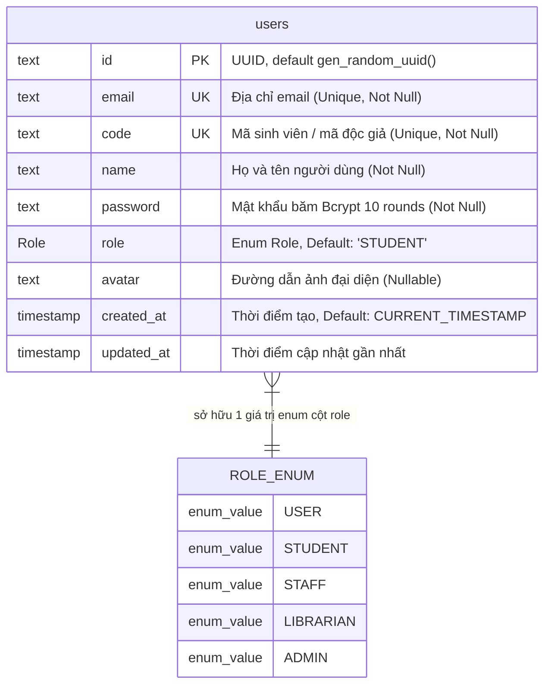
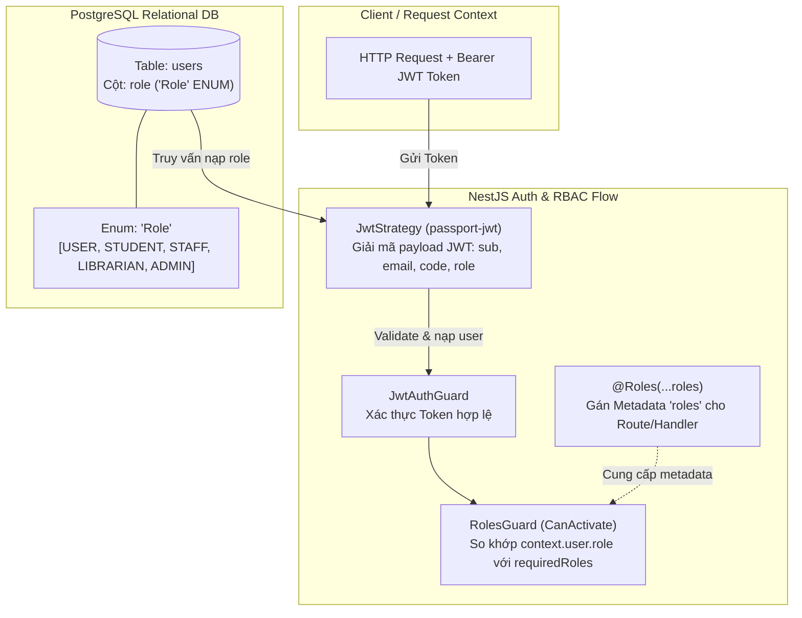

# TÀI LIỆU ĐỐI CHIẾU DATABASE SCHEMA & CƠ CHẾ PHÂN QUYỀN
## HỆ THỐNG QUẢN LÝ THƯ VIỆN ĐẠI HỌC (UNILIBRARY)

> **Ngày lập báo cáo:** 17/10/2026  
> **Phương pháp thực hiện:** Truy vết mã nguồn thực tế (Codebase & Database Introspection) kết hợp đối chiếu tài liệu đặc tả nghiệp vụ ([`rules.md`](../rules.md), [`docs/SRS_UniLibrary.md`](./SRS_UniLibrary.md), [`docs/DacTa_UniLibrary.md`](./DacTa_UniLibrary.md)).  
> **Nguyên tắc cốt lõi:** Không xem kế hoạch hay tài liệu cũ là bằng chứng tính năng đã triển khai; mọi sơ đồ và kết luận phân quyền bắt buộc căn cứ trên Schema, Migration, Guard, Controller và Service thực tế.

---

## 1. Thông Báo Về Các Kỹ Năng (Skills Verification)

- **Superpowers (`writing-plans`, `verification-before-completion`)**:
  - **Trạng thái:** **Chưa được tích hợp / Không khả dụng** trong phiên làm việc hiện tại của Antigravity (danh sách skill runtime hiện có: `ui-ux-pro-max`, `ui-styling`, `design-system`, `design`, `brand`, `banner-design`, `slides`, `antigravity-guide`, `agy-customizations`).
  - **Xử lý:** Báo cáo minh bạch tình trạng thiếu skill; không tự ý cài đặt repository ngoài hoặc mạo nhận đã sử dụng skill. Công việc phân tích và kiểm chứng được thực hiện độc lập, khách quan bằng các công cụ truy vết mã nguồn (Grep, AST, Database Query trực tiếp).
- **UI/UX Pro Max**:
  - Được tham khảo có chọn lọc để chuẩn hóa cấu trúc tài liệu Markdown, phân cấp tiêu đề, định dạng bảng ma trận phân quyền và thiết kế nhãn Mermaid theo phong cách Academic Clarity (dễ đọc, trực quan, tương phản cao).
  - Không suy đoán cấu trúc database từ giao diện UI; toàn bộ dữ liệu phản ánh mã nguồn thực tế.

---

## 2. Sơ Đồ Mermaid ERD Của Database Hiện Tại (As-Built Database ERD)

Qua truy vấn trực tiếp cơ sở dữ liệu PostgreSQL thực tế (`information_schema.tables` và `information_schema.columns`) cùng file cấu hình ORM [`server/prisma/schema.prisma`](../server/prisma/schema.prisma), hệ thống hiện chỉ có **duy nhất 01 bảng** (`users`) và **01 kiểu liệt kê** (`Role`).



### Chi tiết đặc tính kỹ thuật bảng `users` trong PostgreSQL:
* **Tên bảng thực tế trong Database:** `users` (được map thông qua `@@map("users")` trong Prisma).
* **Khóa chính (PK):** Cột `id` kiểu `text` (sinh tự động qua `uuid()`).
* **Chỉ mục duy nhất (Unique Constraints):**
  - `users_email_key` trên cột `email`.
  - `users_code_key` trên cột `code`.
* **Trạng thái bảng liên quan:** Hiện **CHƯA CÓ** các bảng `books`, `book_copies`, `loans`, `reservations`, `fines`, hay `rooms` trong PostgreSQL / Prisma Schema.

---

## 3. Sơ Đồ Quan Hệ Tài Khoản – Vai Trò (Account - Role Architecture)

### 3.1. Cơ chế lưu trữ thực tế
Hệ thống **không sử dụng** bảng trung gian quan hệ Nhiều - Nhiều (`user_roles`) hoặc bảng danh mục vai trò riêng (`roles table`). Thay vào đó:
1. Vai trò là một **cột đơn giá trị (Single-value column)** nằm trực tiếp bên trong bảng `users`: `role Role @default(STUDENT)`.
2. Kiểu dữ liệu là một **PostgreSQL Native Enum** mang tên `"Role"`, gồm 5 nhãn giá trị: `'USER'`, `'STUDENT'`, `'STAFF'`, `'LIBRARIAN'`, `'ADMIN'`.
3. Một tài khoản tại một thời điểm chỉ nắm giữ **đúng 01 vai trò**.



### 3.2. Luồng nạp và kiểm tra vai trò trong mã nguồn:
1. **Lúc đăng nhập (`AuthService.login`):** Hệ thống truy vấn bảng `users`, ký `accessToken` chứa `payload = { sub, email, code, role }` ([`auth.service.ts`](../server/src/modules/auth/auth.service.ts#L79-L85)).
2. **Lúc gửi request (`JwtStrategy.validate`):** Giải mã token, truy vấn lại `findById` từ `users` để đảm bảo tài khoản tồn tại và gán đối tượng người dùng (kèm `user.role`) vào `request.user` ([`jwt.strategy.ts`](../server/src/modules/auth/strategies/jwt.strategy.ts#L20-L27)).
3. **Lúc phân quyền (`RolesGuard`):** Lấy danh sách vai trò cho phép từ `Reflector` qua key `ROLES_KEY = 'roles'` và kiểm tra:
   $$\text{hasAccess} = \text{requiredRoles.some}(\text{role} \implies \text{user.role} === \text{role})$$

---

## 4. Bảng Phân Quyền Vai Trò (Role & Permission Matrix)

Bảng dưới đây đối chiếu giữa **quy định thiết kế nghiệp vụ** (trong tài liệu `rules.md`, `SRS` và `DacTa`) với **hiện trạng triển khai thực tế** trong mã nguồn Backend.

| Phân hệ / Chức năng nghiệp vụ | Độc giả / Người dùng (`STUDENT` / `USER`) | Nhân viên Thư viện (`LIBRARIAN` / `STAFF`) | Quản trị viên (`ADMIN`) | Hiện trạng thực tế trong Source Code | Căn cứ mã nguồn / API |
| :--- | :---: | :---: | :---: | :--- | :--- |
| **Đăng ký tài khoản mới** | Cho phép | Cho phép | Cho phép | **Đã triển khai** | `POST /api/auth/register` (Mặc định tạo role `STUDENT`) |
| **Đăng nhập hệ thống (JWT)** | Cho phép | Cho phép | Cho phép | **Đã triển khai** | `POST /api/auth/login` (Trả về JWT token chứa role) |
| **Xem hồ sơ cá nhân (`/me`)** | Cho phép | Cho phép | Cho phép | **Đã triển khai** | `GET /api/auth/me` (`@UseGuards(JwtAuthGuard)`) |
| **Đổi mật khẩu / Cập nhật Avatar** | Cho phép | Cho phép | Cho phép | *Chưa triển khai API* | Schema có trường `avatar`, chưa có endpoint cập nhật |
| **Gán / Nâng cấp quyền người dùng** | Từ chối | Từ chối | Cho phép | *Chưa triển khai API* | Chưa có controller hay service hỗ trợ cập nhật `user.role` |
| **Quản lý danh mục đầu sách (CRUD)** | Chỉ xem | Tạo / Sửa | Toàn quyền | *Chưa có Backend API* | Dữ liệu sách hiện lưu tại Mock/Client catalog |
| **Quản lý bản sao vật lý (Barcode/RFID)** | Từ chối | Quét mã / Sửa | Toàn quyền | *Chưa có Backend API* | Chưa có schema `book_copies` |
| **Lập phiếu mượn / Nhận trả sách** | Được phục vụ | Thao tác quầy | Toàn quyền | *Chưa có Backend API* | Chưa có schema `loans` |
| **Gia hạn thời gian mượn sách** | Tự gia hạn | Thao tác quầy | Toàn quyền | *Logic Client-side* | Frontend có giao diện, chưa có API backend |
| **Đăng ký giữ chỗ / Đặt trước (FIFO)** | Đăng ký | Duyệt / Trả chỗ | Cấu hình | *Logic Client-side* | Frontend có giao diện, chưa có API backend |
| **Tính & Thu phí phạt trễ hạn** | Nộp phí | Thu tiền / In | Báo cáo | *Chưa có Backend API* | Chưa có schema `fines` |
| **Cấu hình hạn mức mượn (US03)** | Xem | Áp dụng | Cấu hình | *Chưa có Backend API* | Hạn mức hiện định nghĩa tĩnh theo tài liệu |

---

## 5. Căn Cứ Từ File Nguồn (Source Code Traceability)

Tất cả các khẳng định trong tài liệu này được kiểm chứng chính xác dựa trên các file mã nguồn sau:

1. **[`server/prisma/schema.prisma`](../server/prisma/schema.prisma)** (Dòng 10–30):
   - Khai báo enum `Role` với 5 giá trị: `USER`, `STUDENT`, `STAFF`, `LIBRARIAN`, `ADMIN`.
   - Khai báo model `User` duy nhất, cột `role Role @default(STUDENT)`.
2. **[`server/src/common/decorators/roles.decorator.ts`](../server/src/common/decorators/roles.decorator.ts)** (Dòng 1–6):
   - Định nghĩa custom decorator `@Roles(...roles: Role[])` dùng để gắn danh sách quyền vào route metadata.
3. **[`server/src/common/guards/roles.guard.ts`](../server/src/common/guards/roles.guard.ts)** (Dòng 1–22):
   - Triển khai `RolesGuard` so sánh `user?.role` với `requiredRoles`.
4. **[`server/src/modules/auth/auth.controller.ts`](../server/src/modules/auth/auth.controller.ts)** (Dòng 16–51):
   - Khai báo 3 endpoint: `register`, `login`, `getMe`.
   - Không có endpoint nào gắn `@Roles(...)`.
5. **[`server/src/modules/auth/auth.service.ts`](../server/src/modules/auth/auth.service.ts)** (Dòng 19–60, 62–93):
   - Logic băm mật khẩu `bcrypt.hash(password, 10)`.
   - Cấp phát JWT token kèm `payload.role`.
6. **[`server/src/modules/users/users.service.ts`](../server/src/modules/users/users.service.ts)** (Dòng 9–42):
   - Các hàm tìm kiếm: `findByEmail`, `findByCode`, `findById`, `findByEmailOrCode`.
   - Chưa có hàm cập nhật vai trò (`updateRole`) hay danh sách phân trang người dùng (`findAll`).
7. **PostgreSQL Database Engine**:
   - Truy vấn `information_schema.tables WHERE table_schema='public'` $\implies$ Kết quả: duy nhất bảng `users`.
   - Truy vấn `SELECT enumlabel FROM pg_enum` $\implies$ Khẳng định 5 nhãn enum của `Role`.

---

## 6. Mâu Thuẫn Giữa Tài Liệu Và Code & Các Điểm Chưa Xác Minh

### 6.1. Mâu thuẫn giữa Tài liệu và Hiện trạng Code:
1. **Mâu thuẫn về Cấu trúc Database:**
   - *Tài liệu (`rules.md`, `SRS`, `DacTa`):* Mô tả hệ thống gồm 4 phân hệ lớn: Quản lý Bản sao cá biệt, Bổ sung kiểm kê, Lưu thông Mượn/Trả, Hàng đợi Đặt trước, Báo cáo tài chính.
   - *Hiện trạng Code:* Database PostgreSQL và Schema Prisma mới dừng lại ở phân hệ Xác thực người dùng (bảng `users`). Các bảng nghiệp vụ cốt lõi chưa được sinh ra trong database.
2. **Mâu thuẫn về Cơ chế gán vai trò (`Role Assignment`):**
   - *Tài liệu:* Quy định phân quyền rõ ràng giữa `ADMIN`, `LIBRARIAN`/`STAFF` và `STUDENT`.
   - *Hiện trạng Code:* Mọi người dùng khi đăng ký qua API `POST /api/auth/register` đều nhận vai trò mặc định là `STUDENT`. Không có API hoặc giao diện cho phép chỉ định quyền `LIBRARIAN` hoặc `ADMIN`. Hiện tại trong database chỉ có thể nâng quyền bằng cách can thiệp trực tiếp qua câu lệnh SQL (`UPDATE users SET role = 'ADMIN' WHERE ...`).
3. **Mâu thuẫn về Áp dụng Guard (`RBAC Enforcement`):**
   - *Tài liệu (`rules.md` mục 3):* Quy định bắt buộc sử dụng `@UseGuards(JwtAuthGuard, RolesGuard)` kết hợp `@Roles(Role.ADMIN, Role.STAFF)`.
   - *Hiện trạng Code:* `RolesGuard` đã được viết hoàn chỉnh nhưng chưa được áp dụng trên bất kỳ Controller nào trong backend.

### 6.2. Các điểm chưa xác minh trong môi trường vận hành:
1. **Kiểm tra quyền đa vai trò (Multi-role):** Kiến trúc hiện tại sử dụng 1 cột enum duy nhất, do đó một người không thể vừa là `STUDENT` vừa là `STAFF` nếu không thay đổi schema sang bảng quan hệ N-N.
2. **Dữ liệu mượn trả và đặt trước ở Frontend:** Hiện tại toàn bộ dữ liệu sách, tác giả, lịch sử mượn trả và đặt trước FIFO đang vận hành bằng Mock Data và LocalStorage phía client; chưa được lưu trữ bền vững (persistent) vào cơ sở dữ liệu PostgreSQL.

---

## 7. Đề Xuất Kế Hoạch Tách Riêng (Actionable Recommendations)

Để đưa hệ thống từ hiện trạng (MVP Auth) lên đúng quy chuẩn thiết kế nghiệp vụ của tài liệu đặc tả, nhóm phát triển cần triển khai theo các bước sau:

### Giai đoạn 1: Mở rộng Prisma Schema & Migration Database
Bổ sung các model nghiệp vụ vào [`server/prisma/schema.prisma`](../server/prisma/schema.prisma) và chạy migration:
```prisma
enum CopyStatus {
  AVAILABLE
  BORROWED
  RESERVED
  MAINTENANCE
  LOST
}

enum LoanStatus {
  BORROWED
  OVERDUE
  RETURNED
}

enum ReservationStatus {
  WAITING
  READY_FOR_PICKUP
  COMPLETED
  CANCELLED
  EXPIRED
}

model Book {
  id          String      @id @default(uuid())
  title       String
  author      String
  year        Int
  publisher   String?
  callNumber  String      @map("call_number")
  isbn        String?     @unique
  ddcCode     String?     @map("ddc_code")
  category    String
  copies      BookCopy[]
  createdAt   DateTime    @default(now()) @map("created_at")

  @@map("books")
}

model BookCopy {
  id           String        @id @default(uuid())
  bookId       String        @map("book_id")
  barcode      String        @unique
  rfidTag      String?       @unique @map("rfid_tag")
  location     String
  status       CopyStatus    @default(AVAILABLE)
  book         Book          @relation(fields: [bookId], references: [id])
  loans        Loan[]
  reservations Reservation[]

  @@map("book_copies")
}

model Loan {
  id         String     @id @default(uuid())
  userId     String     @map("user_id")
  copyId     String     @map("copy_id")
  borrowDate DateTime   @default(now()) @map("borrow_date")
  dueDate    DateTime   @map("due_date")
  returnDate DateTime?  @map("return_date")
  renewCount Int        @default(0) @map("renew_count")
  status     LoanStatus @default(BORROWED)
  user       User       @relation(fields: [userId], references: [id])
  copy       BookCopy   @relation(fields: [copyId], references: [id])

  @@map("loans")
}

model Reservation {
  id            String            @id @default(uuid())
  userId        String            @map("user_id")
  copyId        String?           @map("copy_id")
  requestDate   DateTime          @default(now()) @map("request_date")
  queuePosition Int               @map("queue_position")
  status        ReservationStatus @default(WAITING)
  user          User              @relation(fields: [userId], references: [id])
  copy          BookCopy?         @relation(fields: [copyId], references: [id])

  @@map("reservations")
}
```

### Giai đoạn 2: Triển khai Quản lý Người dùng & Gán quyền RBAC
1. Tạo `UsersController` với các endpoint quản lý độc giả:
   - `GET /api/users`: Dành riêng cho `ADMIN` và `LIBRARIAN` để tra cứu thẻ độc giả.
   - `PATCH /api/users/:id/role`: Dành riêng cho `ADMIN` để phân quyền người dùng (`@Roles(Role.ADMIN)`).
2. Viết Seed script (`prisma/seed.ts`) tạo sẵn 01 tài khoản `ADMIN` và 01 tài khoản `LIBRARIAN` mặc định ban đầu để phục vụ kiểm thử và vận hành hệ thống.
